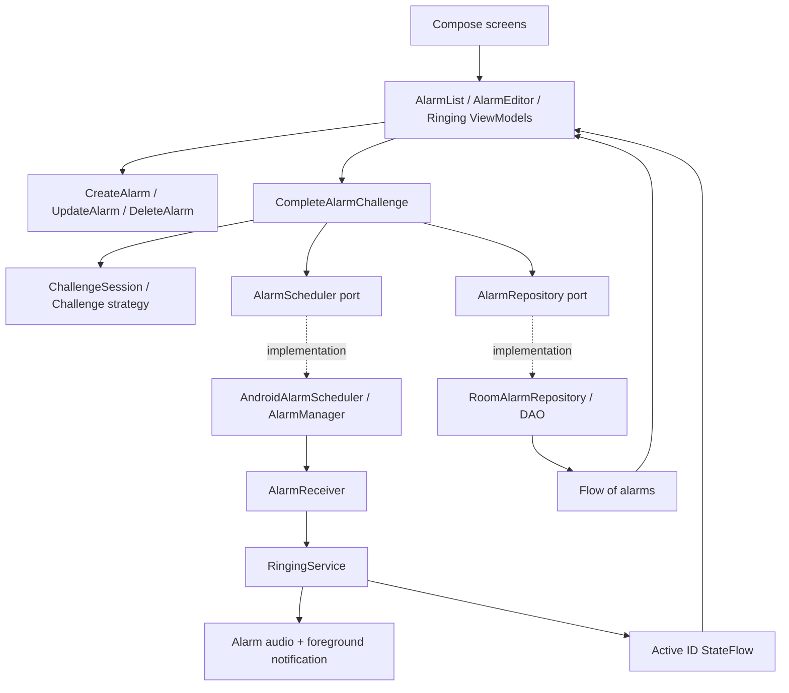

# Architecture and extension guide

## Boundaries

The app uses a small layered design with unidirectional UI state. The domain owns business rules; Android owns delivery mechanics. A foreground service, rather than a composable or ViewModel, owns sound so screen lifecycle changes do not stop it.

`DaybreakApplication` is the explicit composition root. It creates one Room repository, scheduler, challenge registry, and application coroutine scope. `AlarmListViewModel`, `AlarmEditorViewModel`, and `RingingViewModel` each expose one read-only StateFlow of immutable UI state and accept explicit commands. They are ordinary ViewModels with constructor dependencies, created by a small lifecycle ViewModel factory at the composition root. No ViewModel holds an Application, Context, Intent, or another ViewModel. The Activity owns the three screen models so their state survives rotation, including temporary creation drafts and the generated challenge; this is not process-death persistence. Repository writes are suspending Room DAO calls; Room executes database work off the main thread. StateFlow collection uses `collectAsStateWithLifecycle`.

## Why three modules

`core:domain` is independently testable on the JVM and contains no Android imports. `core:data` isolates persistence and schema generation. `app` groups the modest UI and OS integration surface. Splitting every feature into an API/implementation module would add more Gradle and navigation complexity than useful isolation at this scale. These boundaries can support later extraction of a `feature:alarm` or dedicated challenge UI module.

## Data

`Alarm`: UUID primary key, label, epoch-millisecond trigger time, stable challenge ID, question, salted normalized answer digest, enabled flag. Room v1 is exported to `core/data/schemas`. There is no destructive migration fallback. Future schema changes require an explicit migration and upgrade test.

Question normalization is UTF-8, `trim()`, and lowercase using `Locale.ROOT`. The per-alarm UUID is a salt; SHA-256 avoids retaining the answer verbatim but is **not password-grade protection** against offline guessing. The question is plaintext. Personal answers must not contain passwords or sensitive facts. The app disables Android backup for this first increment.

The active ringing ID is a small SharedPreferences record plus a StateFlow; persisted alarms remain the source for their configuration. A ViewModel keeps the generated prompt across rotation. This is not yet a durable ringing-session ledger: process recreation may generate a new puzzle and unexpected termination can leave a stale active ID. See operations and release gates.

## Critical sequences

Create: validate → persist record → schedule `setAlarmClock` → show success. If scheduling throws, remove the record. A process crash between persistence and scheduling is still possible; robust reconciliation is planned.

Delivery: explicit immutable PendingIntent identified by UUID URI → receiver → immediate foreground notification → load enabled alarm → persist active ID → loop default alarm audio → show challenge through notification/full-screen access when allowed.

Completion: submit action + answer → shared use case verifies → snooze schedules five minutes from injected clock, or dismiss disables record → repository write → cancel delivery on dismiss → request playback stop through AlarmPlayback → clear active ID. Validation failures or scheduling failures do not reach the stop-service call. UI serializes submissions with a busy flag.

There is no atomic transaction spanning Room and AlarmManager. A failure after snooze scheduling but before the database write can leave an extra pending delivery. A durable desired-schedule/outbox record and idempotent reconciliation are the appropriate hardening step, not pretending two systems share a transaction.

## State and concurrency

Enabled + future trigger means pending. Active ID means ringing. Correct snooze returns to pending; correct dismiss sets enabled false. Missed alarms are disabled on restore. The current data model intentionally does not persist a richer status enum or event history.

Only one service and one visible challenge are active. A different delivered alarm is deferred by a minute. This policy is not a durable queue and may lose that deferral if permission or persistence fails. The first alarm is not intentionally silenced. Android may terminate services; START_STICKY and the saved active ID offer best-effort recreation, not guaranteed delivery.

## Add a challenge

1. Implement `Challenge` with a stable, versioned ID such as `word.v1`, prompt creation, and answer validation.
2. Register it in `ChallengeRegistry`; duplicate IDs fail at construction. Add localized title metadata in the Android presentation mapping. App-owned prompt wording belongs in resources; domain prompt content carries data. Personal question text stays verbatim.
3. Add tests for accepted, rejected, malformed, and empty input, plus persistence compatibility.
4. For text-answer challenges with existing prompt content shapes the challenge screen works unchanged. A new generated prompt shape adds a domain content type and its localized presentation renderer. Rich input such as QR scanning needs a Compose renderer keyed by challenge ID and an equivalent submission payload. Do not force camera input into a string answer just to preserve an interface.
5. Add creation configuration fields and a schema migration only if the strategy needs persisted configuration. The current model's question/digest fields are intentionally simple; move to a versioned configuration representation when requirements justify it.

Scheduling, audio playback, and the common snooze/dismiss completion flow do not need to know how an answer is verified. Existing IDs must continue to resolve after upgrades; unknown IDs fail closed rather than bypassing the gate. Provide a safe recovery UX before shipping third-party strategies.

## Test seams

Inject `Random` for puzzle generation, `Clock` for snooze timing, and repository/scheduler ports for side-effect checks. Domain tests verify wrong answers cannot schedule, cancel, or persist. Android instrumentation must cover Room and the OS adapters; JVM tests cannot prove exact delivery or lock-screen behavior.

## MVVM refactor status

ADR-16 is implemented for the current three UI flows. Creation and deletion delegate to focused domain use cases. The ringing ViewModel keeps its ChallengeSession private and exposes only the alarm/prompt for rendering; both actions still use CompleteAlarmChallenge. An AlarmPlayback adapter in the composition root checks the active alarm ID, requests service shutdown, then clears the shared active ID. The service remains the sole player owner.

UI commands flow down; immutable state flows up. Creation success is a state flag acknowledged by the route, rather than a callback passed into the ViewModel. Snackbar messages are acknowledged conditionally so an older acknowledgement cannot clear newer feedback. Busy flags are set before launching commands, blocking rapid duplicate submissions. Each screen owns its busy state; DeleteAlarm also checks the shared active ID. The active ID flow itself is read-only outside the composition root.

Creation drafts live only in memory; closing or successfully saving clears personal answers. Drafts are lost on process death. An active but unavailable/unsupported challenge keeps the route in ringing mode, suppressing creation/list controls; no fallback bypass or playback stop occurs. A loading failure produces feedback without killing the active-ID collector, allowing a subsequent ringing session to load.

ADR-18 now moves English copy into Android resources and maps typed domain failures to app resource IDs, without introducing Android dependencies into domain. Compose resolves message IDs at rendering time, with locale-sensitive snackbar effects. Generated prompt data lives in the ViewModel session; only its presentation changes with locale. The Room schema, service lifecycle, visual design, and scheduling reliability limits remain as before. No generic reducer, event bus, base ViewModel, or additional Gradle module is needed.

## Alarm editor time selection

AlarmTimeField is a presentation component accepting/emitting LocalTime. It formats the time card using the system clock preference and locale; the creation route stores only a confirmed value in the existing draft. Material picker state and the dial/keyboard mode are saveable presentation state; the AlarmEditorViewModel owns the confirmed draft. Cancel/back/outside dismissal never writes it. The picker has no repository, scheduling or challenge dependencies and is reused by the shared create/edit form. See ADR-19 for the Material/ChromaDial tradeoff and design references.

## Editing existing alarms

ADR-20 records the update semantics and failure windows. AlarmEditorViewModel owns one create/edit state, including the original Alarm snapshot and a plaintext-free prefilled draft. UpdateAlarm reads the current row, rejects a stale/missing or actively ringing record, and uses shared preparation with CreateAlarm. Persist the replacement configuration, then schedule the same ID. Exceptions/cancellation trigger best-effort row/registration compensation; an explicit localized recovery message distinguishes incomplete restoration. This is not durable reconciliation or a transaction spanning Room and AlarmManager.

Save & schedule enables the alarm. Unchanged future enabled times preserve the original instant; changed/past/completed selections schedule their next local occurrence. A blank answer preserves the digest only for an unchanged personal question; strategy switches and question changes follow ADR-20. Playback and the common snooze/dismiss gate do not participate in ordinary editing. The modal's validation feedback remains visible while it is open. Domain rules remain JVM-testable and Android-independent; there is no schema migration or new dependency.
