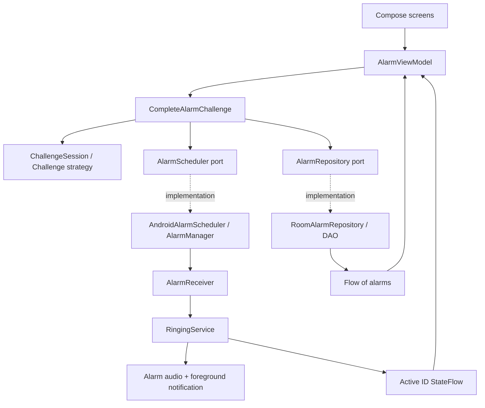

# Architecture and extension guide

## Boundaries

The app uses a small layered design with unidirectional UI state. The domain owns business rules; Android owns delivery mechanics. A foreground service, rather than a composable or ViewModel, owns sound so screen lifecycle changes do not stop it.

`DaybreakApplication` is the explicit composition root. It creates one Room repository, scheduler, challenge registry, and application coroutine scope. `AlarmViewModel` holds screen state and launches commands. Repository writes are suspending Room DAO calls; Room executes database work off the main thread. StateFlow collection uses `collectAsStateWithLifecycle`.

## Why three modules

`core:domain` is independently testable on the JVM and contains no Android imports. `core:data` isolates persistence and schema generation. `app` groups the modest UI and OS integration surface. Splitting every feature into an API/implementation module would add more Gradle and navigation complexity than useful isolation at this scale. These boundaries can support later extraction of a `feature:alarm` or dedicated challenge UI module.

## Data

`Alarm`: UUID primary key, label, epoch-millisecond trigger time, stable challenge ID, question, salted normalized answer digest, enabled flag. Room v1 is exported to `core/data/schemas`. There is no destructive migration fallback. Future schema changes require an explicit migration and upgrade test.

Question normalization is UTF-8, `trim()`, and lowercase using `Locale.ROOT`. The per-alarm UUID is a salt; SHA-256 avoids retaining the answer verbatim but is **not password-grade protection** against offline guessing. The question is plaintext. Personal answers must not contain passwords or sensitive facts. The app disables Android backup for this first increment.

The active ringing ID is a small SharedPreferences record plus a StateFlow; persisted alarms remain the source for their configuration. A ViewModel keeps the generated prompt across rotation. This is not yet a durable ringing-session ledger: process recreation may generate a new puzzle and unexpected termination can leave a stale active ID. See operations and release gates.

## Critical sequences

Create: validate → persist record → schedule `setAlarmClock` → show success. If scheduling throws, remove the record. A process crash between persistence and scheduling is still possible; robust reconciliation is planned.

Delivery: explicit immutable PendingIntent identified by UUID URI → receiver → immediate foreground notification → load enabled alarm → persist active ID → loop default alarm audio → show challenge through notification/full-screen access when allowed.

Completion: submit action + answer → shared use case verifies → snooze schedules five minutes from injected clock, or dismiss disables record → repository write → cancel delivery on dismiss → clear active ID → stop playback service. Validation failures or scheduling failures do not reach the stop-service call. UI serializes submissions with a busy flag.

There is no atomic transaction spanning Room and AlarmManager. A failure after snooze scheduling but before the database write can leave an extra pending delivery. A durable desired-schedule/outbox record and idempotent reconciliation are the appropriate hardening step, not pretending two systems share a transaction.

## State and concurrency

Enabled + future trigger means pending. Active ID means ringing. Correct snooze returns to pending; correct dismiss sets enabled false. Missed alarms are disabled on restore. The current data model intentionally does not persist a richer status enum or event history.

Only one service and one visible challenge are active. A different delivered alarm is deferred by a minute. This policy is not a durable queue and may lose that deferral if permission or persistence fails. The first alarm is not intentionally silenced. Android may terminate services; START_STICKY and the saved active ID offer best-effort recreation, not guaranteed delivery.

## Add a challenge

1. Implement `Challenge` with a stable, versioned ID such as `word.v1`, a title, prompt creation, and answer validation.
2. Register it in `ChallengeRegistry`; duplicate IDs fail at construction.
3. Add tests for accepted, rejected, malformed, and empty input, plus persistence compatibility.
4. For text-answer challenges the existing challenge screen works unchanged. Rich input such as QR scanning needs a Compose renderer keyed by challenge ID and an equivalent submission payload. Do not force camera input into a string answer just to preserve an interface.
5. Add creation configuration fields and a schema migration only if the strategy needs persisted configuration. The current model's question/digest fields are intentionally simple; move to a versioned configuration representation when requirements justify it.

Scheduling, audio playback, and the common snooze/dismiss completion flow do not need to know how an answer is verified. Existing IDs must continue to resolve after upgrades; unknown IDs fail closed rather than bypassing the gate. Provide a safe recovery UX before shipping third-party strategies.

## Test seams

Inject `Random` for puzzle generation, `Clock` for snooze timing, and repository/scheduler ports for side-effect checks. Domain tests verify wrong answers cannot schedule, cancel, or persist. Android instrumentation must cover Room and the OS adapters; JVM tests cannot prove exact delivery or lock-screen behavior.
