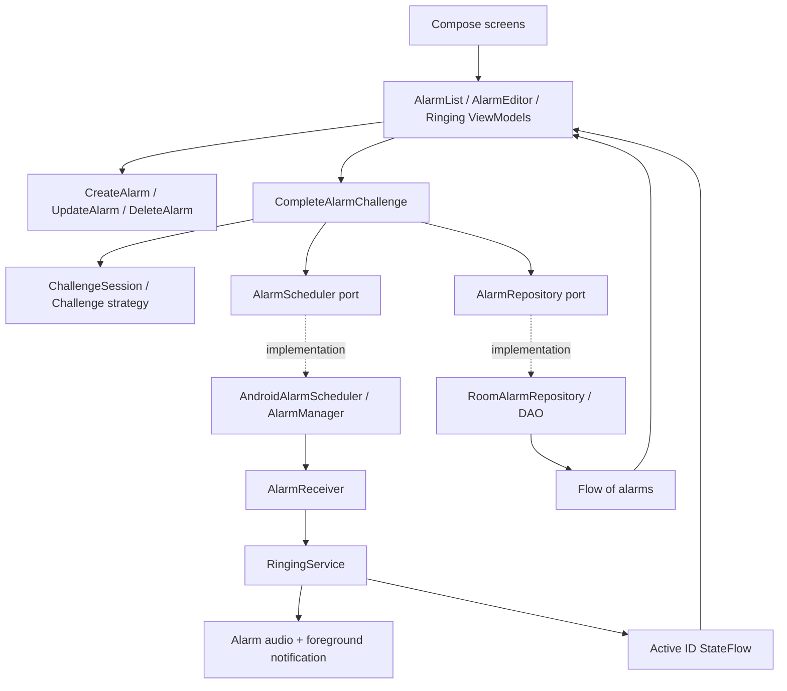

# Architecture and extension guide

## Boundaries

The app uses a small layered design with unidirectional UI state. The domain owns business rules; Android owns delivery mechanics. A foreground service, rather than a composable or ViewModel, owns sound so screen lifecycle changes do not stop it.

`DaybreakApplication` is the explicit composition root. It creates one Room repository, scheduler, challenge registry, and application coroutine scope. `AlarmListViewModel`, `AlarmEditorViewModel`, and `RingingViewModel` each expose one read-only StateFlow of immutable UI state and accept explicit commands. They are ordinary ViewModels with constructor dependencies, created by a small lifecycle ViewModel factory at the composition root. No ViewModel holds an Application, Context, Intent, or another ViewModel. The Activity owns the three screen models so their state survives rotation, including temporary creation drafts and the generated challenge; this is not process-death persistence. Repository writes are suspending Room DAO calls; Room executes database work off the main thread. StateFlow collection uses `collectAsStateWithLifecycle`.

## Why three modules

`core:domain` is independently testable on the JVM and contains no Android imports. `core:data` isolates persistence and schema generation. `app` groups the modest UI and OS integration surface. Splitting every feature into an API/implementation module would add more Gradle and navigation complexity than useful isolation at this scale. These boundaries can support later extraction of a `feature:alarm` or dedicated challenge UI module.

## Data

`Alarm`: UUID primary key, label, epoch-millisecond trigger time, stable challenge ID, question, salted normalized answer digest, enabled flag. Room v1 and v2 schemas are exported to `core/data/schemas`. There is no destructive migration fallback. Future schema changes require an explicit migration and upgrade test.

Question normalization is UTF-8, `trim()`, and lowercase using `Locale.ROOT`. The per-alarm UUID is a salt; SHA-256 avoids retaining the answer verbatim but is **not password-grade protection** against offline guessing. The question is plaintext. Personal answers must not contain passwords or sensitive facts. The app disables Android backup for this first increment.

Room occurrence phases now provide durable ringing/snooze state (ADR-23); the active-ID StateFlow is a process-local UI/window cache. A ViewModel retains its generated prompt across rotation, but process recreation still regenerates the puzzle. Durable challenge prompt/session storage remains separate release-hardening work.

## Critical sequences

Create: validate → atomically persist record and schedule command → schedule `setAlarmClock` → show success. If scheduling throws, remove the record and retain a cancellation command. A process crash leaves desired-state work for replay.

Delivery: explicit immutable PendingIntent identified by UUID URI → receiver → immediate foreground notification → validate enabled alarm and expected trigger → atomically claim RINGING → update active cache → loop default alarm audio → show challenge through notification/full-screen access when allowed.

Completion: submit action + answer → shared gate verifies → compare/write desired occurrence and scheduling command atomically → apply OS scheduling/cancellation → request playback stop and clear the active cache. Snooze preserves the rule; weekly dismiss rearms the next occurrence and one-time dismiss completes it. Validation failures or scheduling failures do not reach the stop-service call. UI serializes submissions with a busy flag.

There is no atomic transaction spanning Room and AlarmManager. An interruption after persisting desired state but before applying or acknowledging the OS effect leaves replayable work. ADR-23 implements durable desired-schedule/outbox replay; it provides eventual recovery, not a transaction across these two systems.

## State and concurrency

AlarmPhase identifies scheduled, ringing, snoozed, deferred and completed occurrences. Correct snooze retains the rule; correct dismiss completes a one-time alarm or advances a weekly alarm. Recovery skips missed weekly occurrences and completes missed one-time alarms. The model persists a coalescing scheduling outbox, but not event history or durable challenge prompts.

Only one service and one visible challenge are active. A different delivered alarm is deferred by a minute in a persisted DEFERRED occurrence. The outbox replays its desired schedule, but this remains a single-slot policy rather than a durable multi-alarm queue. The first alarm is not intentionally silenced. Android may terminate services; START_STICKY and the persisted Room RINGING phase offer best-effort recreation, not guaranteed delivery.

## Add a challenge

1. Implement `Challenge` with a stable, versioned ID such as `word.v1`, prompt creation, and answer validation.
2. Register it in `ChallengeRegistry`; duplicate IDs fail at construction. Add localized title metadata in the Android presentation mapping. App-owned prompt wording belongs in resources; domain prompt content carries data. Personal question text stays verbatim.
3. Add tests for accepted, rejected, malformed, and empty input, plus persistence compatibility.
4. For text-answer challenges with existing prompt content shapes the challenge screen works unchanged. A new generated prompt shape adds a domain content type and its localized presentation renderer. Rich input such as QR scanning needs a Compose renderer keyed by challenge ID and an equivalent submission payload. Do not force camera input into a string answer just to preserve an interface.
5. Add creation configuration fields and a schema migration only if the strategy needs persisted configuration. The current model's question/digest fields are intentionally simple; move to a versioned configuration representation when requirements justify it.

Scheduling, audio playback, and the common snooze/dismiss completion flow do not need to know how an answer is verified. Existing IDs must continue to resolve after upgrades; unknown IDs fail closed rather than bypassing the gate. Provide a safe recovery UX before shipping third-party strategies.

## Test seams

Inject `Random` for puzzle generation, `Clock` for snooze timing, and repository/scheduler ports for side-effect checks. Domain tests verify wrong answers cannot schedule, cancel, or persist. Android instrumentation must cover Room and the OS adapters; JVM tests cannot prove exact delivery or lock-screen behavior.

## MVVM refactor status

ADR-16 is implemented for the current three UI flows. Creation and deletion delegate to focused domain use cases. The ringing ViewModel keeps its ChallengeSession private and exposes only the alarm/prompt for rendering; both actions still use CompleteAlarmChallenge. An AlarmPlayback adapter in the composition root checks the active alarm ID, requests service shutdown, then clears the shared active ID. The service remains the sole player owner.

UI commands flow down; immutable state flows up. Creation success is a state flag acknowledged by the route, rather than a callback passed into the ViewModel. Snackbar messages are acknowledged conditionally so an older acknowledgement cannot clear newer feedback. Busy flags are set before launching commands, blocking rapid duplicate submissions. Each screen owns its busy state; DeleteAlarm also checks the shared active ID. The active ID flow itself is read-only outside the composition root.

Creation drafts live only in memory; closing or successfully saving clears personal answers. Drafts are lost on process death. An active but unavailable/unsupported challenge keeps the route in ringing mode, suppressing creation/list controls; no fallback bypass or playback stop occurs. A loading failure produces feedback without killing the active-ID collector, allowing a subsequent ringing session to load.

ADR-18 now moves English copy into Android resources and maps typed domain failures to app resource IDs, without introducing Android dependencies into domain. Compose resolves message IDs at rendering time, with locale-sensitive snackbar effects. Generated prompt data lives in the ViewModel session; only its presentation changes with locale. The Room schema, service lifecycle, visual design, and scheduling reliability limits remain as before. No generic reducer, event bus, base ViewModel, or additional Gradle module is needed.

## Alarm editor time selection

AlarmTimeField is a presentation component accepting/emitting LocalTime. It formats the time card using the system clock preference and locale; the creation route stores only a confirmed value in the existing draft. Material picker state and the dial/keyboard mode are saveable presentation state; the AlarmEditorViewModel owns the confirmed draft. Cancel/back/outside dismissal never writes it. The picker has no repository, scheduling or challenge dependencies and is reused by the shared create/edit form. See ADR-19 for the Material/ChromaDial tradeoff and design references.

## Editing existing alarms

ADR-20 records the original update semantics and failure windows; ADR-23 adds transactional compare-and-write and durable replay. AlarmEditorViewModel owns one create/edit state, including the original Alarm snapshot and a plaintext-free prefilled draft. UpdateAlarm rejects a stale/missing or ringing record and uses shared preparation with CreateAlarm. Persist the replacement configuration and command, then schedule the same ID. Exceptions/cancellation trigger best-effort conditional compensation; localized feedback distinguishes incomplete restoration. Room and AlarmManager remain separate systems.

Save & schedule enables the alarm. Unchanged future enabled times and repeat rules preserve the current occurrence; changed/past/completed selections schedule their next local occurrence. A blank answer preserves the digest only for an unchanged personal question; strategy switches and question changes follow ADR-20. Playback and the common snooze/dismiss gate do not participate in ordinary editing. The modal's validation feedback remains visible while it is open. Domain rules remain JVM-testable and Android-independent; recurrence adds the Room v2 migration without a new runtime dependency.

## Full-screen and idle delivery — ADR-21

The Android delivery path now bridges receiver -> service -> prepared player using bounded partial wake-lock ownership. Each startup lock times out after 30 seconds and has an idempotent process-local token. The receiver releases on failed service launch; the service releases its receiver token only after taking ownership, then releases its startup token after MediaPlayer starts or on failure/destruction. MediaPlayer retains its alarm audio wake policy during playback.

RingingService serializes delivery loads with a Mutex. It posts a silent loading foreground notification first, validates the enabled row and active slot, then posts the ringing notification with conditional full-screen access under a distinct ID. Duplicate and overlapping deliveries keep the existing active alert/player. AlarmNotifications isolates notification/channel/explicit PendingIntent policy from both the service's orchestration and the domain. The channel stays silent because the service owns sound; user channel importance is never forcibly raised. Setup checks expose app, channel and full-screen restrictions separately.

MainActivity only applies alarm lock-screen/window wake flags while the shared active ID is present. Notification taps and permitted full-screen intents open the same challenge. The Android 15+ creator opt-in is limited to the immutable full-screen alarm intent; no ViewModel/activity owns background playback or launches a bypass flow. API 34+ denial has a notification-tap fallback when notifications are allowed. Android still selects heads-up/full-screen behavior. Audio startup failure remains a visible ongoing challenge with diagnostic notification; robust fallback is future work. See ADR-21 and OPERATIONS.md for limits.

## Weekly recurrence and reconciliation — ADR-23

RepeatRule holds local time plus selected weekdays. Alarm.triggerAtMillis is the next delivery, while occurrenceAtMillis anchors the current occurrence and AlarmPhase distinguishes scheduled/ringing/snoozed/deferred/completed. The editor preserves rule time while editing a snoozed alarm, shares validation with one-time creation, and uses locale-specific weekday labels/order. Empty day selection means once only. The list shows the next delivery plus repeat-day summary. See ADR-23 for DST/travel/coalescing rules.

Room v2 transactionally writes alarm changes together with an ID-keyed schedule command carrying an opaque token. Deletes retain a cancellation tombstone. ReconcileSchedules serializes replay, applies the current desired registration/cancellation, and acknowledges only the matching token. Retry after an OS effect but before acknowledgement is idempotent; stale acknowledgement cannot erase newer work. This gives eventual durable desired-state recovery, not a transaction with AlarmManager or an authoritative query of its registrations.

Foreground refresh requeues desired rows, recovers persisted ringing state and starts journal observation for subsequent writes. Boot/update/permission/clock/zone receivers also refresh; reboot skips old ringing/missed occurrences. Foreground recovery preserves due deliveries for a 60-second handoff grace, while explicit system refresh has no grace. Future weekly schedules follow the current zone, while one-time instants and pending snoozes/deferrals stay absolute. Transactional compare-and-write rejects stale edit/delete/completion/service claims. Expected-trigger extras reject superseded deliveries; legacy extras remain compatible when due.

Completion persists desired occurrence state before applying scheduling: snooze updates the occurrence only, dismiss of a weekly rule rearms its next match, and dismiss of a one-time alarm completes it. Failed OS application attempts compensation; dirty journal state remains replayable even across interruption. The service alone owns sound. SharedPreferences no longer owns active ringing state. Physical recovery evidence, durable prompts, audio fallback and richer overlap handling are still required before production claims.
