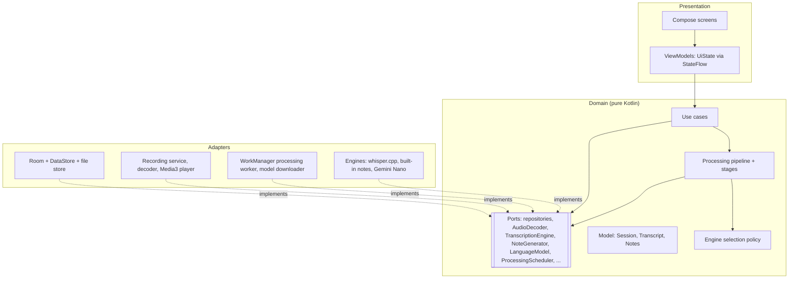
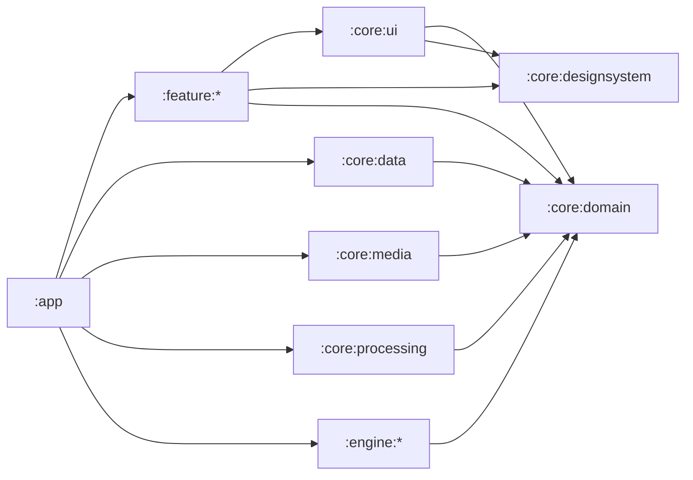
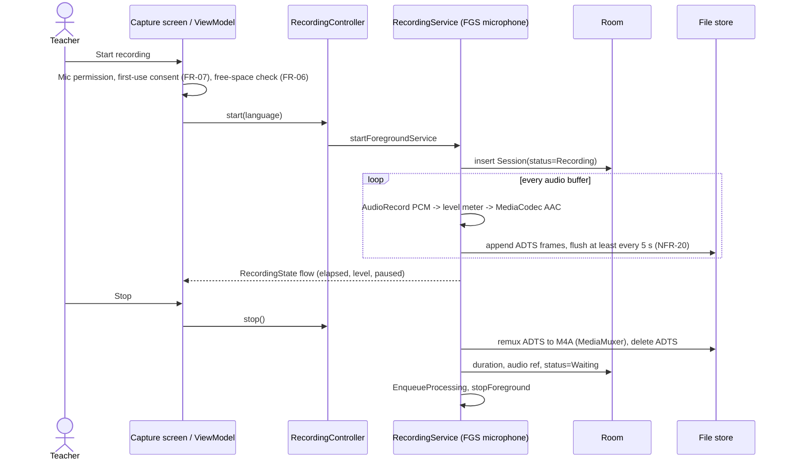
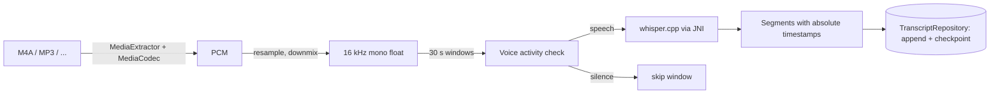
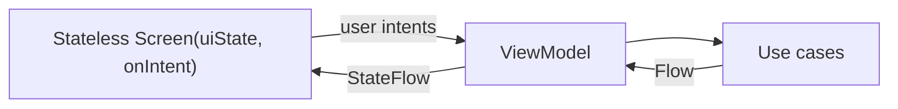

# High-level design — NotesMaker

Status: **Draft v0.3 (2026-11-19)**. Design only; no code exists yet.
Inputs: [product requirements](PRODUCT_REQUIREMENTS.md) (FR/NFR IDs) and [decision log](DECISIONS.md) (ADR-01 to ADR-09). New decisions made in this document are ADR-10 to ADR-18; ADR-19 sets the benchmark device tiers.
Detailed by: the [low-level design](LOW_LEVEL_DESIGN.md) (schema, state machines, threading, native build, prompts, manifest, test plan) and the [internal API design](API_DESIGN.md) (exact Kotlin contracts), with ADR-20 to ADR-30. Where this document and those differ, the more detailed document wins and the difference is listed in Section 12.

## 1. Purpose and scope

This document describes how NotesMaker is split into parts, what each part owns, how the parts talk to each other, and how the main flows (record, import, process, browse, play) run through them. It is the bridge between "what the app does" (the PRD) and "how each class is written" (the LLD).

It answers four questions:

1. **Structure:** which layers and Gradle modules exist, and which way dependencies point (Section 3 and 4).
2. **Behavior:** how recording, import, processing, model download and playback work at runtime, including process death and Android's background limits (Section 6).
3. **Extensibility:** where the plug-in points are and what adding a new engine, stage, input or export format touches (Section 8).
4. **Risk:** what is still uncertain and how it will be checked (Section 11).

## 2. Architectural drivers

The requirements that shape the design most, in priority order:

| Driver | Source | Design consequence |
| --- | --- | --- |
| No recorded audio is lost | FR-05, NFR-20 | Crash-safe recording format and recovery on start-up (ADR-14) |
| Hours-long processing that survives the app leaving the screen, process death and reboot | FR-20 to FR-24, NFR-21 | Durable queue in the database, one WorkManager worker, checkpoints per stage and per transcription chunk (ADR-13) |
| Replaceable engines, inputs, outputs and stages | NFR-60 to NFR-63, NFR-65 | Ports owned by the domain, adapters in their own modules, registration by DI multibinding, a capability-based selection policy (ADR-10, ADR-11, ADR-12, ADR-15) |
| Some engines only run in the foreground or on some devices | Constraint 9.1, ADR-03, ADR-04 | Engines report capability; the pipeline picks the best *currently runnable* engine and records an "upgrade available" flag instead of blocking (ADR-15) |
| Domain logic testable on the JVM | NFR-64, NFR-70 | Pure Kotlin domain module, no Android imports |
| Long transcripts exceed model input limits | FR-45, constraint 9.3 | Chunking and combining live in the domain, shared by every LLM-backed generator (ADR-16) |
| Explainable design for a learning project | Goal 6, NFR-66 | Each abstraction has a named second implementation, a test seam or a listed extension; no speculative layers |

## 3. Architecture overview

### 3.1 Style

NotesMaker uses a **layered architecture with ports and adapters** (also called hexagonal or "clean" architecture), and **MVVM with unidirectional data flow** in the presentation layer (ADR-10).

- The **domain layer** is the center. It holds the model (Session, Transcript, Notes), the use cases, the processing pipeline and the **ports**: interfaces for everything the domain needs from the outside world (storage, audio decoding, transcription, note generation, scheduling).
- **Adapters** implement those ports with Android and third-party technology: Room, the file system, MediaCodec, whisper.cpp, ML Kit, WorkManager.
- The **presentation layer** (Compose screens and ViewModels) calls use cases and observes data as `Flow`s. It never talks to an adapter directly.
- The **app module** is the composition root. It wires everything with Hilt and owns the activity, navigation and Android manifest entries.

Dependencies always point inward: presentation and adapters depend on the domain; the domain depends on nothing Android.

### 3.2 Layer diagram



### 3.3 Main runtime components

| Component | Kind | Responsibility | Lifetime |
| --- | --- | --- | --- |
| `MainActivity` | Activity | Hosts Compose, navigation, permission requests, deep links | UI visible |
| Screen ViewModels | `ViewModel` | Turn domain flows into one `UiState` per screen; accept user intents | Navigation entry |
| `RecordingService` | Foreground service, type `microphone` | Owns the microphone, encoder and recording file for the whole recording | Start to stop of a recording |
| `ProcessingWorker` | `CoroutineWorker` with foreground info | Drains the processing queue one session at a time | While sessions are waiting |
| `ModelDownloadWorker` | `CoroutineWorker` | Downloads and verifies speech models | Per download |
| `PlaybackService` | Media3 `MediaSessionService` | Background voice-note playback with media controls | While playing |
| `StartupRecovery` | App start-up task | Recovers interrupted recordings, re-enqueues interrupted processing, deletes orphaned temp files | Once per process start |
| Room database | Storage | Sessions, transcripts, notes, processing state | Persistent |
| DataStore | Storage | User preferences: sort order, default language, model choice, consent shown | Persistent |
| File store | Storage | Audio files and speech models in app-private storage | Persistent |

## 4. Module structure

### 4.1 Modules

NotesMaker is one Gradle project at `apps/notesmaker/` (ADR-01) with modules grouped by role (ADR-11). Module names below are the Gradle paths.

| Module | Type | Owns | Depends on |
| --- | --- | --- | --- |
| `:app` | Android application | `Application`, `MainActivity`, navigation graph, Hilt components, manifest, `StartupRecovery`, notification channels | All feature, core and engine modules |
| `:core:domain` | **Pure Kotlin (JVM)** | Model, use cases, ports, pipeline and stages, engine selection policy, transcript chunker, sorting, failure types | Kotlin stdlib, coroutines core, `javax.inject` |
| `:core:data` | Android library | Room database and DAOs, DataStore, file store, repository implementations, migrations | `:core:domain` |
| `:core:media` | Android library | `RecordingService`, encoder and remuxer, audio decoder (file to 16 kHz PCM), audio probe, `PlaybackService` | `:core:domain` |
| `:core:processing` | Android library | `ProcessingWorker`, `ModelDownloadWorker`, the WorkManager-backed `ProcessingScheduler`, processing notifications, foreground state tracker | `:core:domain` |
| `:core:designsystem` | Android library | Theme, typography, shared composables (status chip, timestamp text, empty state, audio level meter) | Compose only |
| `:core:ui` | Android library | Shared presentation helpers: `UiText`, failure-to-message mapping, duration and date formatting | `:core:domain`, `:core:designsystem` |
| `:feature:capture` | Android library | Capture screen and ViewModel (record, import, permission and consent flow) | `:core:domain`, `:core:ui`, `:core:designsystem` |
| `:feature:sessions` | Android library | Sessions list screen and ViewModel (sort, status, empty state, search later) | same |
| `:feature:session` | Android library | Session details: notes, transcript tab, player controls, rename, edit, export, delete | same |
| `:feature:settings` | Android library | Settings and model management screens | same |
| `:engine:whisper` | Android library + NDK | whisper.cpp source build (CMake), JNI bridge, `WhisperTranscriptionEngine` | `:core:domain` |
| `:engine:notes-basic` | **Pure Kotlin (JVM)** | Built-in extractive note generator (ADR-04 baseline) | `:core:domain` |
| `:engine:notes-gemini-nano` | Android library | `LanguageModel` adapter over the ML Kit GenAI Prompt API | `:core:domain` |
| `build-logic` | Included build | Convention plugins that share Android, Kotlin, Compose, Hilt and test setup across modules | — |

Planned later modules, listed so the design accounts for them (NFR-66):

| Module | Release | Purpose |
| --- | --- | --- |
| `:engine:speech-mlkit` | 0.2 or 0.3 | ML Kit GenAI Speech Recognition adapter (ADR-02, item 4) |
| `:export:text` | 0.2 | Markdown and plain-text exporters (FR-67) |
| `:engine:cloud-*` | 0.3+ | Opt-in cloud transcription or language model adapters (ADR-05) |
| `:export:pdf` | 0.3+ | PDF export (FR-68) |

### 4.2 Dependency rules



Rules, enforced by module boundaries rather than by convention:

1. `:core:domain` depends on no other project module and no Android library.
2. A feature module never depends on another feature module. Cross-screen navigation goes through route types owned by `:app` (ADR-17).
3. A feature module never depends on `:core:data`, `:core:media`, `:core:processing` or any engine. It sees only domain use cases and ports, so a screen cannot reach around the domain.
4. An engine module depends only on `:core:domain`. Engines never know about each other, the pipeline order, the database or the UI.
5. Only `:app` sees every module, because it is where implementations are bound to ports.

Rule 3 has one deliberate, narrow exception: the session details screen needs a Compose-friendly player handle. `:core:domain` defines a small `VoiceNotePlayer` port (play, pause, seek, position as a `Flow`), implemented in `:core:media`, so the feature module still depends only on the domain.

## 5. Domain model

### 5.1 Entities and value types

| Type | Key fields (indicative; LLD fixes them) | Notes |
| --- | --- | --- |
| `Session` | id (UUID), title, titleSource (generated, fallback, user), createdAt, durationMs, origin (recorded, imported), language, audio reference, status, stage, progress, failure, upgradeAvailable | The aggregate root. Everything else hangs off a session ID. |
| `SessionStatus` | `Recording`, `Waiting`, `Processing`, `Ready`, `Failed`, `Cancelled` | Matches FR-50. `Cancelled` is shown as Failed with reason "Cancelled" and a Retry action. |
| `StageId` | `PrepareAudio`, `Transcribe`, `GenerateNotes`, `Finalize` | String-backed value class, so a new stage is a new value, not an enum change in persisted data. |
| `Transcript` | sessionId, engineId, modelId, language, segments | |
| `TranscriptSegment` | index, startMs, endMs, text | Ordered, non-overlapping. Unit of seeking (FR-31, FR-63). |
| `Notes` | sessionId, title, summary, sections, highlights, generatorId, generatedAt, edited flags | One structured shape every generator fills (ADR-16). |
| `NoteSection` | heading, startMs, endMs, body (list of points) | Time-ordered, non-overlapping (FR-42). |
| `Highlight` | kind (key point, definition, formula, date, instruction), text, atMs | Up to 10 (FR-43). |
| `EngineInfo` | id, display name, kind (transcription or notes), runs on device or cloud | Used by Settings and by the "produced by" label (FR-44). |
| `Capability` | `Ready`, `NeedsModel(modelId, sizeBytes)`, `NeedsForeground`, `NeedsOptIn`, `Unsupported(reason)` | Returned by every engine (NFR-65). |
| `ProcessingFailure` | sealed: `ModelMissing`, `AudioUnreadable`, `OutOfMemory`, `EngineUnavailable`, `StorageFull`, `TimedOut`, `Cancelled`, `Unknown` | Mapped to a message and a recovery action in `:core:ui` (NFR-23). |
| `SpeechModel` | id, engineId, language set, quality tier, sizeBytes, sha256, url, installed | Catalog entry (ADR-06). |

### 5.2 Ports (interfaces owned by the domain)

| Port | Implemented in | Why it is an interface (NFR-66) |
| --- | --- | --- |
| `SessionRepository`, `TranscriptRepository`, `NotesRepository` | `:core:data` | Test seam: in-memory fakes for JVM tests of use cases and the pipeline |
| `ProcessingCheckpointStore` | `:core:data` | Test seam; keeps checkpoint logic out of Room DAOs |
| `AudioStore` | `:core:data` | Test seam; owns file paths so nothing else builds paths |
| `PreferencesRepository` | `:core:data` | Test seam |
| `AudioDecoder` (file to a `Flow` of 16 kHz mono PCM windows) | `:core:media` | Test seam with synthetic PCM; isolates MediaCodec |
| `AudioProbe` (can it be decoded, how long is it) | `:core:media` | Test seam; used by import and recovery |
| `RecordingController` | `:core:media` | Test seam for the Capture ViewModel; hides the service |
| `VoiceNotePlayer` | `:core:media` | Keeps Media3 out of feature modules |
| `TranscriptionEngine` | `:engine:whisper`, later `:engine:speech-mlkit` | Two real implementations planned (ADR-02) |
| `NoteGenerator` | `:engine:notes-basic`, domain `LlmNoteGenerator` | Two real implementations at 0.1 (ADR-04) |
| `LanguageModel` | `:engine:notes-gemini-nano`, later cloud or local LLM | Planned second implementation (ADR-04 item 4, ADR-05) |
| `ProcessingScheduler` | `:core:processing` | Test seam; hides WorkManager from use cases |
| `ModelCatalog`, `ModelInstaller` | `:core:data`, `:core:processing` | Test seam; download is WorkManager-specific |
| `ForegroundState` (is the UI visible now) | `:core:processing` | Needed by the selection policy for foreground-only engines |
| `Clock` | `:core:domain` default plus test fake | Deterministic tests for timestamps and fallback titles |
| `NotesExporter` | `:export:text` (0.2) | Two formats planned (FR-67, FR-68, NFR-62) |

### 5.3 Use cases

Use cases are small classes with one public operation, named for the user goal. The main ones for 0.1:

| Use case | Called by | What it does |
| --- | --- | --- |
| `StartRecording`, `PauseRecording`, `ResumeRecording`, `StopRecording`, `DiscardRecording` | Capture ViewModel, notification actions | Delegate to `RecordingController`; `StopRecording` finalizes the session and calls `EnqueueProcessing` |
| `ImportAudio` | Capture ViewModel | Copy to a temp file, probe, enforce the 3-hour limit, create the session, enqueue |
| `EnqueueProcessing` | Stop, import, retry, recovery | Mark the session `Waiting` with a queue timestamp; ask `ProcessingScheduler` to make sure the worker runs |
| `ProcessNextSession` | `ProcessingWorker` | Take the oldest waiting session and run the pipeline on it |
| `CancelProcessing`, `RetryProcessing` | Session details, Sessions list | Update state; retry keeps completed stages (FR-22, FR-23) |
| `ObserveSessions(sort)` | Sessions ViewModel | Flow of list items, sorted by the chosen order (FR-51, FR-53) |
| `ObserveSessionDetails(id)` | Session ViewModel | Flow combining session, notes and transcript |
| `RenameSession`, `EditNotes`, `DeleteSession` | Session ViewModel | FR-64 to FR-66 |
| `RegenerateNotes(generatorId?)` | Session ViewModel | Re-run only the notes stage from the saved transcript (FR-46, and "Improve notes") |
| `ListEngines`, `InstallModel`, `DeleteModel` | Settings ViewModel | FR-70, FR-35 |
| `RecoverInterruptedWork` | `StartupRecovery` | See Section 6.6 |

## 6. Key flows

### 6.1 Record a live session



Points worth calling out:

- **Crash-safe format (ADR-14).** The service writes AAC frames in the ADTS format, where each frame is self-describing. If the process dies, every frame already flushed is playable. A standard M4A file written by `MediaRecorder` is unreadable until it is closed properly, which would break FR-05. On stop, the ADTS stream is remuxed into M4A without re-encoding, so the stored voice note still matches ADR-08.
- **Pause** stops feeding the encoder while keeping the service and file open, so paused time is not in the audio (FR-03). Timestamps continue from the last written frame.
- **Interruptions** (FR-05): the service listens for audio recording configuration changes (another app silencing the microphone, API 29+), audio focus loss and phone calls, and pauses automatically, updating the notification. Exact signals per API level go to the LLD.
- **State to the UI** flows through a process-wide `StateFlow` held by the `RecordingController` adapter. The service writes it; the ViewModel reads it. Commands go to the service as explicit intents, which also lets notification actions (Pause, Stop) work without the UI.
- **Low storage:** the service checks free space each minute and stops cleanly below a threshold (FR-06).

### 6.2 Import an audio file

1. The Capture screen launches the system picker (`OpenDocument` with audio MIME types).
2. `ImportAudio` copies the content into a temp file in app storage, so later processing does not depend on the original (FR-10). Copy progress is shown for large files.
3. `AudioProbe` checks that the file decodes and reads its duration. Unsupported or corrupt files, or files over 3 hours, are rejected with a clear message and the temp file is deleted (FR-11, FR-12). No session row exists until the probe passes.
4. The temp file is moved to the session folder, the session is created as `Waiting`, and processing is enqueued.

The copy runs in an application-scoped coroutine, not in the ViewModel scope, so rotating or leaving the screen does not cancel it. If the process dies mid-copy, `StartupRecovery` deletes the orphaned temp file and no half-created session appears. The share-target flow (FR-13, 0.2) enters at step 2.

### 6.3 Processing pipeline

#### Queue and worker (ADR-13)

- The **database is the queue**. A session with status `Waiting` and a queue timestamp is queued. Order is by queue timestamp (FR-24).
- `ProcessingScheduler.ensureRunning()` enqueues **one unique WorkManager job** named `session-processing` with `ExistingWorkPolicy.KEEP`. If the job is already running, nothing happens; the running worker will pick the new session up.
- The worker loops: take the next waiting session, run the pipeline, repeat until the queue is empty, then finish.
- The worker promotes itself to a **foreground service** with a progress notification, using type `mediaProcessing` on Android 15+ and `dataSync` below (ADR-03). Both types have a 6-hour daily limit on Android 15+; a 3-hour session fits, and if the system ends the work at the limit, it resumes from the last checkpoint later.
- The UI **never reads WorkManager state**. The worker writes stage, progress and failure to the session row, and every screen observes the database. One source of truth means the list, details and notification always agree, including after process death.

#### Stage contract

The pipeline is an ordered list of stages that share one contract (Pipeline pattern with a per-stage checkpoint; NFR-63):

```text
interface PipelineStage {
    val id: StageId
    suspend fun isComplete(session): Boolean          // checkpoint present and valid?
    suspend fun run(session, progress: ProgressSink): StageOutcome
}
StageOutcome = Completed | Deferred(reason) | Failed(ProcessingFailure)
```

The `ProcessingPipeline` runs stages in order, skips completed ones (resume, FR-22), reports progress, and stops at the first `Failed`. Each stage writes its output through a repository in a single transaction that replaces any earlier output for that session, which makes stages idempotent (NFR-21).

| Stage | Input | Output | Checkpoint |
| --- | --- | --- | --- |
| `PrepareAudio` | Session audio | Verified duration, decodability | Session duration set |
| `Transcribe` | Audio via `AudioDecoder` | Transcript segments | **Per chunk**: segments are appended per 30-second window together with the last processed audio position, so a crash 50 minutes into a 60-minute file loses at most one window (ADR-13) |
| `GenerateNotes` | Transcript | `Notes` | Notes row exists for the current transcript |
| `Finalize` | Notes | Title applied (unless user-edited, FR-64), status `Ready`, completion notification (FR-20) | Status `Ready` |

#### Engine selection (ADR-15)

Engines are registered through Hilt multibinding (ADR-12) and chosen by an `EngineSelector` in the domain:

1. Collect all registered engines of the needed kind.
2. Drop those the user has not opted into (cloud, ADR-05) and those reporting `Unsupported`.
3. Order by the policy: the user's preferred engine first if set, then the engine's declared quality rank.
4. Return the first engine reporting `Ready` **now**, plus whether a better engine exists that is only blocked by `NeedsForeground`.

For transcription in 0.1 there is one engine, so the policy mainly gives a clear failure (`ModelMissing`, with an Install action) when the model is absent. For notes, the policy is what implements ADR-04: Gemini Nano when the app is visible and the device supports it, otherwise the built-in generator, with `upgradeAvailable = true` on the session. The details screen then offers "Improve notes", which runs `RegenerateNotes` while the user is looking at it.

#### Cancellation

`CancelProcessing` marks the session `Cancelled` and, if it is the one currently running, cancels the coroutine inside the worker. whisper.cpp receives the cancellation through its abort callback between decode steps. The worker then continues with the next waiting session.

### 6.4 Transcription with whisper.cpp



- **Decoding** is streamed: PCM is never written to disk in full (ADR-08). A window is about 2 MB of float samples.
- **Native integration:** whisper.cpp is built from a pinned source version with CMake for `arm64-v8a` and `x86_64`. The JNI layer is thin: load a model, transcribe one window with an initial prompt (the tail of the previous window's text, for continuity), return segments, abort. All model state is owned by one Kotlin object that serializes calls on a single dedicated thread; whisper.cpp uses its own worker threads inside a call.
- **Memory:** one model context per process, loaded at the start of the `Transcribe` stage and released at its end, keeping peak memory within NFR-13. The spike (ADR-02) measures the real figure.
- **Voice activity detection** reduces invented text on silence and saves time. whisper.cpp's built-in VAD is the first candidate; an energy threshold is the fallback. The LLD chooses after the spike.

### 6.5 Note generation (ADR-16)

Two kinds of generator fill the same `Notes` shape:

- **`BasicNoteGenerator`** (`:engine:notes-basic`) implements `NoteGenerator` directly with deterministic rules: TextRank-style sentence scoring for the summary, time windows refined by vocabulary shifts for sections, keyword frequency for the title and section headings, and pattern rules for highlights ("remember", "important", "is defined as", dates, "due", "assignment"). Always available, instant, unit-tested on the JVM.
- **`LlmNoteGenerator`** lives in the domain and implements `NoteGenerator` on top of any `LanguageModel`. It owns the **chunk-then-combine** algorithm:
  1. `TranscriptChunker` splits segments into chunks that fit the model's input budget, never splitting a segment, with timestamps kept as `[mm:ss]` markers.
  2. **Map:** for each chunk, ask the model for a structured partial result (key points, candidate section headings with start times, candidate highlights with times).
  3. **Reduce:** ask the model to combine the partial results into the final title, summary, sections and highlights. If the partial results are too large, reduce in rounds.
  4. **Validate:** parse the structured output, clamp times to the chunk range, sort and de-overlap sections, cap highlights at 10, truncate the title to 80 characters. A chunk that fails validation is retried once, then the whole generation fails and the selector falls back to the built-in generator.

A `LanguageModel` adapter only has to do three things: report its capability, report its input token budget, and turn a prompt plus an output schema into text. The Gemini Nano adapter wraps the ML Kit GenAI Prompt API. A future cloud model or local Gemma model is another small adapter; the chunking, prompts and validation are reused (Template Method and Adapter patterns).

Prompts are versioned resources owned by the domain, so a prompt change is visible in review and can be compared on the test transcripts.

### 6.6 Start-up recovery

On every process start, before the Capture screen needs it, `StartupRecovery` runs `RecoverInterruptedWork`:

1. **Interrupted recordings:** any session still `Recording` while the recording service is not running had its process killed. Remux the ADTS file that exists so far into M4A, set the duration, mark the session as recovered, and enqueue it (FR-05).
2. **Interrupted processing:** any session `Processing` is set back to `Waiting` with its original queue position, and `ensureRunning()` is called. Checkpoints make the restart cheap.
3. **Orphans:** temp import files and session folders without a database row are deleted.

After a reboot the worker is rescheduled by WorkManager, but Android 15+ does not allow these foreground service types to start from `BOOT_COMPLETED`, and Android 12+ limits starting foreground services from the background. If promotion to the foreground is refused, the worker returns "retry" and processing resumes as soon as it is allowed, at the latest when the user next opens the app. This is a documented limitation, not a failure state.

### 6.7 Model download

`InstallModel` enqueues a `ModelDownloadWorker` with an unmetered-network constraint by default (FR-33). The worker downloads to a partial file with HTTP range requests so it can resume, verifies the SHA-256 checksum from the pinned catalog bundled in the app, and moves the file into the models folder only after verification (NFR-34). Progress is shown in Settings and, if a session is waiting for that model, on the session. Sessions blocked by `ModelMissing` are re-enqueued automatically when the model install completes.

### 6.8 Playback and seeking

`PlaybackService` is a Media3 `MediaSessionService` with ExoPlayer, giving background playback and notification media controls for free (FR-61). The `VoiceNotePlayer` adapter connects to it with a `MediaController`. Tapping a section, highlight or transcript line calls `seekTo(ms)` (FR-62, FR-63). The current position is exposed as a `Flow` so the transcript tab can highlight the line being spoken.

## 7. Presentation layer

### 7.1 Screen architecture

Each screen follows the same MVVM and unidirectional data flow shape (ADR-10):



- One immutable `UiState` per screen, exposed as a `StateFlow` built with `stateIn(WhileSubscribed(5s))`, collected with `collectAsStateWithLifecycle`.
- User actions are functions on the ViewModel (`onStartRecording()`, `onSortChanged(order)`), not a generic event bus.
- One-off effects that must not replay after rotation (open the share sheet, show a snackbar) are modeled as state that the screen consumes and acknowledges, not as a `SharedFlow`, which avoids lost events.
- Each screen is split into a **stateful route** composable that talks to the ViewModel and a **stateless screen** composable that only renders state. Previews and UI tests use the stateless one.
- Strings come from resources through a `UiText` type so ViewModels stay testable and translation-ready (NFR-52).

### 7.2 Navigation (ADR-17)

Single activity (ADR-09) with **Jetpack Navigation 3**. The back stack is a list of typed route keys owned by `:app`; each feature module exposes an entry builder for its routes.

| Route | Screen | Arguments |
| --- | --- | --- |
| `Capture` | Start destination | — |
| `Sessions` | Sessions list | — |
| `SessionDetails` | Notes, transcript, player | sessionId |
| `Settings` | Settings | — |
| `Models` | Model management | optional modelId to highlight |

- On wide screens (tablets, unfolded foldables, landscape) Sessions and SessionDetails show side by side as a **list-detail** layout, using Navigation 3 scenes with the Material 3 adaptive layout (NFR-04).
- Notifications deep-link into `SessionDetails` (processing finished) and `Capture` (recording in progress) with an explicit intent that the activity converts into a back stack.
- Bottom navigation (phone) or navigation rail (wide) switches between Capture, Sessions and Settings.

### 7.3 Sorting and the sessions list

- The sort order is stored in DataStore (FR-52) and combined with the sessions flow from Room in `ObserveSessions` (FR-53).
- **Date** sorts happen in SQL. **Title** sorts happen in the domain with a locale-aware collator, because SQLite's built-in collations do not handle accents or the user's locale (FR-51). With the expected volume (NFR-15 targets 1,000 sessions of a few hundred bytes each), sorting in memory takes well under a frame.
- The list is a `LazyColumn` with stable keys (session ID) and lightweight list-item models, without Paging (ADR-18). Paging is reconsidered when full-text search over transcripts arrives (FR-55 stretch).

## 8. Extensibility: how to add things

These walkthroughs are the concrete test of NFR-60 to NFR-63. Each lists every file area that changes.

| To add | Do this | Untouched |
| --- | --- | --- |
| **A transcription engine** (for example ML Kit speech) | New module `:engine:speech-mlkit` implementing `TranscriptionEngine` with a capability check; one Hilt `@IntoSet` binding; add the module to `:app`; pass the shared contract tests | Pipeline, stages, other engines, all screens. Settings lists it automatically from the registry. |
| **A language model for notes** (for example cloud or local Gemma) | New module implementing `LanguageModel`; one binding that wraps it in an `LlmNoteGenerator` | Chunking, prompts, validation, pipeline, UI |
| **A whole new note strategy** | Implement `NoteGenerator` directly; one binding | Same as above |
| **A pipeline stage** (for example translation or quiz generation) | Implement `PipelineStage` with a new `StageId`; add it to the ordered stage list in the pipeline module definition; add any new output table with a migration | Existing stages and engines. The stage list in DI is the only shared line that changes. |
| **An input** (for example a Bluetooth microphone or a URL) | Produce an audio file in app storage, then call the same `CreateSession` + `EnqueueProcessing` path that record and import use (NFR-61) | Pipeline and everything after it |
| **An export format** (for example PDF) | Implement `NotesExporter` with its MIME type; one `@IntoSet` binding. The share menu lists all exporters | Markdown exporter, session screen logic |
| **A screen** | New `:feature:*` module with its route, entry builder and ViewModel; register the entry in `:app` | Other features |

## 9. Cross-cutting concerns

### 9.1 Dependency injection (ADR-12)

Hilt, with KSP. `:app` holds the `@HiltAndroidApp` application and the modules that bind adapters to ports. Engines contribute to `Set<TranscriptionEngine>`, `Set<NoteGenerator>` and `Set<NotesExporter>` through `@IntoSet`. Workers use `@HiltWorker` with the Hilt worker factory. The domain uses only the plain `javax.inject.Inject` annotation, so it stays pure Kotlin.

### 9.2 Concurrency

| Concern | Approach |
| --- | --- |
| Main thread | Only UI and state mapping. Nothing that touches disk, codecs or models (NFR-14). |
| Dispatchers | Injected (`@IoDispatcher`, `@DefaultDispatcher`), never hard-coded, so tests use a test dispatcher. |
| Scopes | `viewModelScope` for screen work; an injected application `CoroutineScope` for work that outlives a screen (import copy, recording state); WorkManager for anything that must survive process death. |
| whisper.cpp | One dedicated single-thread dispatcher for JNI calls; whisper uses its own native threads, sized from the CPU count. |
| Recording | The audio read loop runs on a dedicated thread inside the service; encoder output is written on the same loop to keep frame order simple. |
| Cancellation | Cooperative everywhere; native code checks an abort flag. |

### 9.3 Persistence

| Store | Contents | Notes |
| --- | --- | --- |
| Room | sessions, transcript segments, notes, note sections, highlights, transcription checkpoint | Exported schemas, versioned migrations with tests, no destructive fallback (NFR-22). Foreign keys cascade on session delete. |
| DataStore (Preferences) | sort order, default language, model quality, consent shown, defer-on-low-battery | Small key-value settings; asynchronous and safe across processes. |
| Files (`filesDir/sessions/<id>/`) | `audio.m4a`, temporary `audio.aac` while recording | Excluded from backup (NFR-33). Deleted with the session (FR-66). |
| Files (`filesDir/models/`) | Verified speech models; `.partial` files while downloading | Listed and deletable in Settings (FR-70, NFR-41). |

Deleting a session deletes the row first (inside a transaction), then the files. If the process dies between the two, start-up recovery removes the orphaned folder.

### 9.4 Error handling

Adapters catch technology-specific exceptions (`MediaCodec.CodecException`, `OutOfMemoryError` from model loading, ML Kit errors, I/O errors) at the port boundary and translate them into `ProcessingFailure` or a domain `Result` type. The domain never sees an Android exception. `:core:ui` maps each failure to a message and an action (Retry, Install model, Free up space, Open app) (NFR-23).

### 9.5 Privacy and security

- Only the model download path uses the network in 0.1 (NFR-31). The download client accepts only the catalog's HTTPS URLs.
- `android:allowBackup="false"` and data extraction rules exclude everything (NFR-33).
- No analytics or crash-reporting SDKs (NFR-32). Logging uses Android `Log` behind a small wrapper that strips transcript text in release builds.
- Cloud API keys (0.3+) will be stored with the Android Keystore (NFR-35).

### 9.6 Notifications

Channels: **Recording** (ongoing, low importance, Pause and Stop actions), **Processing** (ongoing progress, Cancel action), **Results** (session ready or failed, default importance), **Downloads** (model progress). Android 13+ notification permission is requested on first record or import, with the app still working if it is denied.

### 9.7 Testing strategy

| Level | What | Where |
| --- | --- | --- |
| JVM unit | Use cases, pipeline resume and idempotency, selection policy, chunker, basic generator, LLM output validation, sorting | `:core:domain`, `:engine:notes-basic` |
| Contract tests | One abstract suite per port (`TranscriptionEngineContract`, `NoteGeneratorContract`, `LanguageModelContract`); each implementation runs it (NFR-71) | Test fixtures shared from `:core:domain` |
| Instrumented | Room DAOs and migrations, encoder and remux round trip, decoder output format, whisper on a short clip | `:core:data`, `:core:media`, `:engine:whisper` |
| UI | Stateless screens with fake state; navigation smoke test | Feature modules, `:app` |
| Quality | Word error rate on fixed lecture-style clips (NFR-74) | A benchmark task, not part of every CI run |

CI follows the repository convention: a `notesmaker.yml` workflow scoped to `apps/notesmaker/**`, running build, unit tests and lint. Native build caching is configured there.

## 10. Requirement traceability

| Requirement group | Main components |
| --- | --- |
| FR-01 to FR-07 Recording | `RecordingService`, `RecordingController`, `StartRecording`…`DiscardRecording`, `StartupRecovery`, Capture screen |
| FR-10 to FR-13 Import | `ImportAudio`, `AudioProbe`, `AudioStore`, Capture screen |
| FR-20 to FR-25 Processing | `ProcessingScheduler`, `ProcessingWorker`, `ProcessingPipeline`, stages, checkpoint store |
| FR-30 to FR-36 Transcription | `TranscriptionEngine`, `:engine:whisper`, `AudioDecoder`, `ModelCatalog`, `ModelDownloadWorker` |
| FR-40 to FR-47 Notes | `NoteGenerator`, `BasicNoteGenerator`, `LlmNoteGenerator`, `LanguageModel`, `:engine:notes-gemini-nano`, `EngineSelector` |
| FR-50 to FR-56 Sessions list | `ObserveSessions`, Sessions screen, `PreferencesRepository` |
| FR-60 to FR-68 Details | `ObserveSessionDetails`, `VoiceNotePlayer`, `PlaybackService`, `NotesExporter` |
| FR-70 to FR-73 Settings | Settings and Models screens, `ListEngines`, `InstallModel` |
| NFR-60 to NFR-66 Modularity | Sections 4, 5.2 and 8 |

## 10a. Performance validation

Performance targets (PRD Section 7.2) are set per device tier (ADR-19):

| Tier | Device | What it validates |
| --- | --- | --- |
| E | Android emulator, API 36, 4 GB RAM | Everything functional: flows, recovery, migrations, UI tests. Peak memory at the 4 GB floor. Trends between builds on the same host. |
| M | Samsung Galaxy A-series (A3x/A5x class) | Pass/fail for cold start, real-time factor, basic notes time, list scrolling. The built-in notes path, since Gemini Nano is not expected. |
| H | Pixel 8 Pro | Upper-bound speed; the Gemini Nano notes path if the Prompt API supports this device (to verify in the spike). |

Consequences for the design:

- `:engine:whisper` builds for both `arm64-v8a` (phones) and `x86_64` (emulator). The x86_64 build is a supported development target, not a performance reference.
- On the emulator, Gemini Nano is unavailable, so the LLM note path is developed against a fake `LanguageModel` (risk R-2), and selection-policy behavior is tested on the JVM.
- Benchmarks record device model, Android version, RAM, model file and build type, so results from different phones are comparable. A Macrobenchmark module for cold start and list scrolling is planned in the LLD.

## 11. Risks and open questions

| ID | Risk or question | Impact | Plan |
| --- | --- | --- | --- |
| R-1 | whisper.cpp is slower than real time on the mid-range test phone (tier M) with the default model | NFR-11 missed; long waits | Spike first (ADR-02). Fallbacks: smaller default model, VAD, or Vosk as a "fast draft" engine through the same port |
| R-2 | Gemini Nano is unavailable on the maintainer's device | The LLM path cannot be tested on real hardware | Develop `LlmNoteGenerator` against a fake `LanguageModel` in JVM tests; consider a local Gemma adapter earlier if needed |
| R-3 | Foreground service start is refused after reboot or from the background | Processing resumes later than expected | Documented behavior (Section 6.6); retry with backoff; resume on next app open |
| R-4 | ADTS recovery or remux has device-specific codec issues | FR-05 at risk | Instrumented round-trip test; keep the ADTS file until remux verification passes |
| R-5 | 15 modules slow the build and confuse a newcomer | Learning friction | Convention plugins keep each module's build file short; module map in the README; modules can be merged later without changing the domain |
| R-6 | LLM output does not follow the structure | Notes fail and fall back to basic too often | Structured output where the API supports it, strict validation, one retry, prompts tested on spike transcripts |
| OQ-3 | Reference device for benchmarks (PRD) | NFR-10 to NFR-13 targets | **Resolved (ADR-19):** emulator baseline, Galaxy A-series for mid-range and Pixel 8 Pro for high-end targets. |
| R-7 | Emulator speed misleads: it depends on the host and on x86_64 builds of whisper.cpp | Wrong conclusions about performance | Speed pass/fail only on tiers M and H; emulator numbers used for trends between builds on the same host (ADR-19) |
| OQ-6 | whisper.cpp source pinning: git submodule, CMake `FetchContent` or vendored copy | Build reproducibility and CI time | **Resolved (ADR-24):** `FetchContent` with a pinned release archive and SHA-256 |
| OQ-7 | HTTP client for model download: OkHttp or `HttpURLConnection` | One dependency | **Resolved (ADR-25):** `HttpURLConnection` behind `HttpFileFetcher` |

## 12. Low-level design and refinements

The items this section listed for the LLD are now covered by the [low-level design](LOW_LEVEL_DESIGN.md) and the [internal API design](API_DESIGN.md). They refine this document in a few places:

| HLD item | Refinement | Record |
| --- | --- | --- |
| `StageOutcome.Deferred` (Section 6.3) | Dropped; the pipeline never waits for the foreground, as ADR-15 already decided | ADR-22 |
| Status updates | Every status change is a compare-and-set transition, so cancel and completion cannot both win | ADR-22 |
| Transcription engine contract | Engines receive the audio file and a resume position and emit committed segments; the stage checkpoints them | ADR-21 |
| `Capability` (Section 5.1) | Adds `NeedsDownload` for system-managed models such as Gemini Nano | API design 5.1 |
| Recording interruptions (Section 6.1) | Audio focus is not requested; calls and microphone silencing are detected through audio mode and recording callbacks. After an interruption, recording stays paused until the user resumes | ADR-26 |
| Voice activity detection (Section 6.4) | Energy-based detector first; whisper.cpp VAD compared in the spike | ADR-28 |
