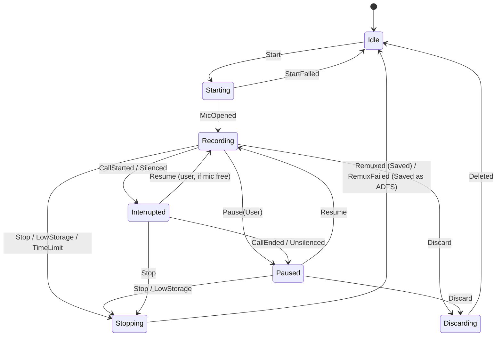

# Low-level design — NotesMaker

Status: **Draft v0.1 (2026-11-19)**. Design only; no code exists yet.
Inputs: [product requirements](PRODUCT_REQUIREMENTS.md) v0.2, [high-level design](HIGH_LEVEL_DESIGN.md) v0.2, [decision log](DECISIONS.md) up to ADR-19. Companion: [internal API design](API_DESIGN.md), which fixes the Kotlin contracts this document implements. New decisions are ADR-20 to ADR-30.

This document answers the questions the HLD left for the LLD (HLD Section 12): build setup, database schema, the recording and processing state machines, native integration, prompts and validation, manifest and notification details per API level, and the test plan. It is written so each section can be implemented as one or two pull requests, in the order given in Section 12.

## 1. Build setup

### 1.1 Gradle layout

```text
apps/notesmaker/
├── settings.gradle.kts          // includeBuild("build-logic"), all modules below
├── gradle/libs.versions.toml
├── build-logic/convention/      // convention plugins
├── app/
├── core/{domain,data,media,processing,designsystem,ui}/
├── feature/{capture,sessions,session,settings}/
└── engine/{whisper,notes-basic,notes-gemini-nano}/
```

Convention plugins, so each module's build file is a few lines (HLD risk R-5):

| Plugin ID | Applied to | Sets up |
| --- | --- | --- |
| `notesmaker.jvm.library` | `:core:domain`, `:engine:notes-basic` | Kotlin JVM, toolchain 21, explicit API mode, JUnit, coroutines-test, `java-test-fixtures` |
| `notesmaker.android.library` | Every Android library | AGP library, `compileSdk 36`, `minSdk 26`, Kotlin Android, lint baseline off, unit test options |
| `notesmaker.android.compose` | Feature modules, `:core:ui`, `:core:designsystem`, `:app` | Compose compiler plugin, BOM, tooling, Compose UI test |
| `notesmaker.android.feature` | Feature modules | `android.library` + `compose` + Hilt + dependencies on `:core:domain`, `:core:ui`, `:core:designsystem` |
| `notesmaker.android.hilt` | Modules that bind or inject | Hilt plugin, KSP, Hilt compiler |
| `notesmaker.android.room` | `:core:data` | Room plugin, KSP, schema directory `schemas/` |
| `notesmaker.android.application` | `:app` | Application plugin, `targetSdk 36`, ABI filters, signing for debug |

The convention plugin `notesmaker.android.feature` adds the allowed dependencies itself, so a feature module cannot accidentally declare `:core:data`. A small Gradle check task, `checkModuleGraph`, fails the build if any project dependency breaks HLD Section 4.2 rules (for example `:feature:*` on `:core:data`, or `:engine:*` on anything except `:core:domain`). It runs in CI.

### 1.2 Versions

The version catalog starts from Daybreak's current versions (AGP 8.13, Kotlin 2.2.21, KSP, Room 2.8, coroutines 1.10, lifecycle 2.9, Compose BOM) so both samples move together. New libraries (Hilt, WorkManager, Navigation 3, Material 3 adaptive, Media3, DataStore, kotlinx.serialization, kotlinx.collections.immutable, ML Kit GenAI Prompt) are pinned to their latest stable versions when the first module that needs them lands, and that pull request records the versions in the catalog. Alpha or beta libraries are allowed only in the module that wraps them (`:engine:notes-gemini-nano` for ML Kit GenAI), so an unstable API cannot spread.

### 1.3 Native build (ADR-24)

`:engine:whisper` builds whisper.cpp from source with the Android Gradle Plugin's CMake integration.

```cmake
# engine/whisper/src/main/cpp/CMakeLists.txt (sketch)
cmake_minimum_required(VERSION 3.22)
project(notesmaker_whisper)
include(FetchContent)
FetchContent_Declare(whisper
    URL      https://github.com/ggml-org/whisper.cpp/archive/refs/tags/${WHISPER_VERSION}.tar.gz
    URL_HASH SHA256=${WHISPER_SHA256})
set(WHISPER_BUILD_TESTS OFF CACHE BOOL "" FORCE)
set(WHISPER_BUILD_EXAMPLES OFF CACHE BOOL "" FORCE)
set(GGML_OPENMP OFF CACHE BOOL "" FORCE)      # use ggml's own thread pool
FetchContent_MakeAvailable(whisper)
add_library(notesmaker_whisper SHARED jni_bridge.cpp)
target_link_libraries(notesmaker_whisper whisper log)
```

- `WHISPER_VERSION` and `WHISPER_SHA256` are passed from Gradle (`externalNativeBuild.cmake.arguments`), defined once in `libs.versions.toml`, so upgrading whisper.cpp is a one-line change with a checksum.
- ABIs: `arm64-v8a` (phones, tiers M and H) and `x86_64` (emulator, tier E), per ADR-19. `arm64-v8a` is compiled with `-march=armv8.2-a+dotprod+fp16` in a second library variant loaded only when the CPU reports those features, because they give a large speed-up on current phones but crash older cores. Loader: `WhisperNativeLoader` reads `/proc/cpuinfo` features once and loads `notesmaker_whisper_v82` or the baseline library.
- Release builds use `-O3` and `-DNDEBUG`; debug builds of the app still use an optimized native build (`CMAKE_BUILD_TYPE=Release`), because a debug whisper.cpp is too slow to test with.
- CI caches the CMake download directory and `.cxx`, keyed on the whisper version.

## 2. Package layout of `:core:domain`

```text
dev.notesmaker.core.domain
├── model/        Session, Transcript, Notes, ids, enums
├── error/        Outcome, ProcessingFailure, CaptureFailure, runCatchingCancellable
├── port/         repositories, media, scheduling, environment ports
├── engine/       Engine, TranscriptionEngine, NoteGenerator, LanguageModel, EngineSelector, EngineRegistry
├── pipeline/     PipelineStage, ProcessingPipeline, StagePlan, stages/
├── notes/        LlmNoteGenerator, TranscriptChunker, NotesPromptSet, StructuredNotesParser, NotesValidator
├── session/      SessionStateMachine, TitleCollator, FallbackTitle
├── recording/    RecordingMachine (pure reducer, Section 4)
└── usecase/      one file per use case
```

## 3. Persistence

### 3.1 Room schema, version 1 (ADR-23)

```sql
CREATE TABLE sessions (
  id                      TEXT    NOT NULL PRIMARY KEY,   -- UUID
  title                   TEXT    NOT NULL,
  title_source            TEXT    NOT NULL,               -- 'fallback' | 'generated' | 'user'
  created_at              INTEGER NOT NULL,               -- epoch ms
  origin                  TEXT    NOT NULL,               -- 'recorded' | 'imported'
  origin_name             TEXT,                           -- imported file display name
  language                TEXT    NOT NULL,               -- BCP 47
  duration_ms             INTEGER,
  audio_path              TEXT,                           -- relative to filesDir/sessions
  status                  TEXT    NOT NULL,               -- SessionStatus name
  stage                   TEXT,                           -- StageId value
  progress                REAL,
  failure_code            TEXT,
  failure_detail          TEXT,                           -- developer detail, never shown raw
  queued_at               INTEGER,
  trigger                 TEXT,                           -- 'initial' | 'retry' | 'regenerate:<engineId>'
  notes_upgrade_available INTEGER NOT NULL DEFAULT 0,
  recovered               INTEGER NOT NULL DEFAULT 0,     -- recording recovered after a crash
  updated_at              INTEGER NOT NULL
);
CREATE INDEX idx_sessions_queue   ON sessions(status, queued_at);
CREATE INDEX idx_sessions_created ON sessions(created_at);

CREATE TABLE transcripts (
  session_id         TEXT    NOT NULL PRIMARY KEY REFERENCES sessions(id) ON DELETE CASCADE,
  engine_id          TEXT    NOT NULL,
  model_id           TEXT,
  language           TEXT    NOT NULL,
  committed_until_ms INTEGER NOT NULL,        -- checkpoint (ADR-13)
  next_index         INTEGER NOT NULL,
  complete           INTEGER NOT NULL,
  revision           INTEGER NOT NULL         -- bumped on each completed transcription
);

CREATE TABLE transcript_segments (
  session_id TEXT    NOT NULL REFERENCES sessions(id) ON DELETE CASCADE,
  idx        INTEGER NOT NULL,
  start_ms   INTEGER NOT NULL,
  end_ms     INTEGER NOT NULL,
  text       TEXT    NOT NULL,
  PRIMARY KEY (session_id, idx)
);

CREATE TABLE notes (
  session_id          TEXT    NOT NULL PRIMARY KEY REFERENCES sessions(id) ON DELETE CASCADE,
  title               TEXT    NOT NULL,       -- generated title; sessions.title is what is shown
  summary_json        TEXT    NOT NULL,       -- JSON array of strings
  summary_edited      INTEGER NOT NULL,
  generator_id        TEXT    NOT NULL,
  model_id            TEXT,
  prompt_version      TEXT,
  transcript_revision INTEGER NOT NULL,
  generated_at        INTEGER NOT NULL
);

CREATE TABLE note_sections (
  session_id  TEXT    NOT NULL REFERENCES sessions(id) ON DELETE CASCADE,
  idx         INTEGER NOT NULL,
  heading     TEXT    NOT NULL,
  start_ms    INTEGER NOT NULL,
  end_ms      INTEGER NOT NULL,
  points_json TEXT    NOT NULL,               -- JSON array of strings
  edited      INTEGER NOT NULL,
  PRIMARY KEY (session_id, idx)
);

CREATE TABLE highlights (
  session_id TEXT    NOT NULL REFERENCES sessions(id) ON DELETE CASCADE,
  idx        INTEGER NOT NULL,
  kind       TEXT    NOT NULL,
  text       TEXT    NOT NULL,
  at_ms      INTEGER NOT NULL,
  edited     INTEGER NOT NULL,
  PRIMARY KEY (session_id, idx)
);
```

Notes on the schema:

- **Child tables use `(session_id, idx)` as the primary key.** Re-running a stage deletes by `session_id` and inserts again in one transaction, and the composite key makes a duplicate insert fail loudly instead of silently doubling segments (NFR-21).
- **Enums are stored as their stable string names**, never ordinals, so reordering an enum cannot corrupt data. Unknown values read from the database (for example after a downgrade) map to a safe default and are logged.
- **Section points and the summary are JSON arrays in a text column**, not a further table. They are always read and written with their parent and never queried on their own. A `TypeConverter` uses kotlinx.serialization.
- `transcripts.revision` lets `GenerateNotesStage.isComplete` check that notes were built from the current transcript (`notes.transcript_revision = transcripts.revision`).
- `failure_detail` is for logs and bug reports only. The UI shows the message mapped from `failure_code` (NFR-23).
- Foreign keys are enabled (`PRAGMA foreign_keys=ON` via Room's default), so deleting a session row removes all children.

The sessions list query reads only the columns of `SessionListItem`, so no transcript or notes data is loaded for the list (NFR-15):

```sql
SELECT id, title, created_at, duration_ms, status, stage, progress FROM sessions ORDER BY created_at DESC
```

### 3.2 Migrations

- `exportSchema = true`, schemas committed under `core/data/schemas/` (like Daybreak).
- Additive changes use Room `@AutoMigration`. Anything else is a hand-written `Migration` with an instrumented `MigrationTestHelper` test from every released version (NFR-22). `fallbackToDestructiveMigration` is never called.
- Planned 0.2 change: an FTS4 table `sessions_fts(title)` kept in sync by Room's `@Fts4(contentEntity = SessionEntity::class)` for title search (FR-55).

### 3.3 DataStore

One Preferences DataStore file `user_prefs`. Keys mirror `UserPreferences` (API Section 3). Enum values are stored by name. Reads that fail with `IOException` emit defaults (the documented DataStore recovery pattern), so a corrupt file never blocks the app.

### 3.4 Files

```text
filesDir/
├── sessions/<id>/audio.aac        while recording or before remux verification
├── sessions/<id>/audio.m4a        final voice note (recorded)
├── sessions/<id>/audio.<ext>      final voice note (imported, original format kept, ADR-08)
├── imports/<uuid>.tmp             import copy before the probe passes
└── models/<modelId>.bin | .partial
cacheDir/exports/                  share-sheet files, cleared on start
```

Only `FileAudioStore` and `FileModelStore` build paths. Every other class holds an `AudioRef` or `ModelId`.

## 4. Recording state machine

### 4.1 States and transitions

The recording logic is a **pure reducer** in the domain (`RecordingMachine`, ADR-26) driven by events from the service. The service only performs the effects the reducer asks for. This makes the trickiest flow in the app testable on the JVM and is the "MVI for the Capture flow" option ADR-10 left open.



After an interruption ends, the machine goes to `Paused`, not back to `Recording`. Resuming automatically after a phone call could record a private conversation in the room; the teacher taps Resume (FR-05 says recording pauses and the user is told).

```kotlin
sealed interface RecEvent { /* Start, MicOpened, StartFailed, Pause, Resume, CallStarted, CallEnded,
                               Silenced, Unsilenced, Tick(nowMs, freeBytes), Stop, Discard,
                               Remuxed, RemuxFailed, Deleted */ }
sealed interface RecEffect { /* OpenMic, CloseMic, StartEncoder, StopFeedingEncoder,
                                ResumeFeedingEncoder, Remux, DeleteFiles, UpdateNotification,
                                EnqueueProcessing(id), Toast(reason) */ }

fun reduce(state: RecState, event: RecEvent): Pair<RecState, List<RecEffect>>
```

Limits enforced by the reducer on each `Tick` (once per second):

| Condition | Action |
| --- | --- |
| Free space below 50 MB | `Stopping` with `StopResult.LowStorage` (FR-06) |
| Recorded audio reaches 3 hours | `Stopping` (FR-12 cap applies to recordings too) |
| Before start: free space below 2 h at the chosen bitrate plus 50 MB | `StartRecording` returns `InsufficientStorage`; the UI warns and lets the user start anyway (FR-06 says warn) |

### 4.2 Interruption signals per API level

| Signal | API 26 to 28 | API 29 to 30 | API 31+ |
| --- | --- | --- | --- |
| Another app takes the microphone | Not possible: concurrent capture is refused to the other app | `AudioManager.AudioRecordingCallback`, `isClientSilenced()` on our config | Same |
| Phone call | `AudioManager.getMode()` polled on each tick (`MODE_IN_CALL`, `MODE_IN_COMMUNICATION`) | Same, plus silencing callback | `AudioManager.OnModeChangedListener` |
| Process death | Startup recovery (Section 5.6) | Same | Same |

The HLD mentioned audio focus. The LLD does not request audio focus: focus is meant for playback, and a recorder holding it would duck or pause the user's other media for two hours. Mode and silencing signals cover the FR-05 cases without needing `READ_PHONE_STATE`. The polling path on old API levels is marked "to verify" in the device test matrix.

### 4.3 Capture loop

Runs on one dedicated plain `Thread` with `Process.THREAD_PRIORITY_URGENT_AUDIO`, owned by `RecordingService`:

1. `AudioRecord` with `VOICE_RECOGNITION` source (no automatic gain designed for calls), 16 kHz for standard quality and 24 kHz for high quality (ADR-08), mono, `ENCODING_PCM_16BIT`, buffer of 4x the minimum size.
2. Read 20 ms buffers. Compute RMS for the level meter and publish it at most every 100 ms.
3. If not paused, queue the buffer into a `MediaCodec` AAC-LC encoder (64 kbps standard, 128 kbps high). Presentation time is computed from **samples fed**, not wall time, so paused periods leave no gap (FR-03).
4. Drain encoder output; prefix each frame with a 7-byte ADTS header and append it to `audio.aac` through a `BufferedOutputStream`.
5. Every 5 seconds: `flush()` and `FileDescriptor.sync()` (NFR-20), and update `sessions.duration_ms` so a recovered session shows its length.

On stop, the encoder is signalled end of stream, drained, closed, and `AdtsToM4aRemuxer` copies samples with `MediaExtractor` (which reads ADTS) into a `MediaMuxer` MPEG-4 file. Verification: the M4A is probed with `AudioProbe`, and its duration must be within 200 ms of the ADTS duration. Only then is `audio.aac` deleted. If remux fails, the session keeps the ADTS file as its audio (it is playable and decodable) and the failure is logged (HLD risk R-4).

## 5. Processing details

### 5.1 Session state machine (ADR-22)

`SessionStateMachine` in the domain lists the allowed transitions. `SessionRepository.transition` performs them as compare-and-set in one SQL `UPDATE ... WHERE id = ? AND status IN (...)`, returning whether a row changed.

| From | Event | To | Who |
| --- | --- | --- | --- |
| — | Recording started | `Recording` | `RecordingService` |
| — | Import committed | `Waiting` | `CreateSessionFromAudio` |
| `Recording` | Saved / recovered | `Waiting` | Service, `RecoverInterruptedWork` |
| `Recording` | Discarded | (row deleted) | Service |
| `Waiting` | Worker picks it | `Processing` | `ProcessNextSession` |
| `Processing` | All stages complete | `Ready` | Pipeline |
| `Processing` | Stage failed | `Failed` | Pipeline |
| `Waiting`, `Processing` | User cancels | `Cancelled` | `CancelProcessing` |
| `Processing` | Process died | `Waiting` (same `queued_at`) | `RecoverInterruptedWork` |
| `Failed`, `Cancelled` | Retry | `Waiting` (new `queued_at`) | `RetryProcessing` |
| `Ready` | Regenerate notes | `Waiting` with trigger `regenerate` | `RegenerateNotes` |
| `Failed` (`ModelMissing`) | Model installed | `Waiting` | `ModelInstalledListener` |

Race examples this prevents:

- The user cancels while the worker is finishing. The worker's final `transition({Processing}, Complete)` returns false because the status is already `Cancelled`, so a cancelled session never flips to `Ready`.
- The user taps Retry twice. The second `transition({Failed, Cancelled}, Enqueue)` returns false; no duplicate queue entry.

`Cancelled` is shown as "Failed: Cancelled" with Retry, as the HLD decided.

### 5.2 Worker loop

```kotlin
@HiltWorker
class ProcessingWorker @AssistedInject constructor(
    @Assisted ctx: Context, @Assisted params: WorkerParameters,
    private val processNext: ProcessNextSession,
    private val notifications: ProcessingNotifications,
    private val running: RunningSessionRegistry,
) : CoroutineWorker(ctx, params) {

    override suspend fun doWork(): Result {
        if (!tryPromoteToForeground()) return Result.retry()        // Section 5.5
        while (true) {
            currentCoroutineContext().ensureActive()
            val result = processNext() ?: return Result.success()  // queue empty
            notifications.showResult(result)
        }
    }
}
```

`ProcessNextSession`:

1. `next = sessions.nextWaiting()`; null ends the loop.
2. `transition(next.id, {Waiting}, Start)`; if false (cancelled in between), skip to the next one.
3. Run `pipeline.run(id, trigger)` inside a child `Job` registered in `RunningSessionRegistry`, so `cancelCurrent(id)` cancels only this session and the loop continues.
4. On `CancellationException` from that child job only, the session is already `Cancelled` by `CancelProcessing`; the loop continues. A cancellation of the worker itself (WorkManager stop) propagates and ends `doWork`; the session stays `Processing` and recovery requeues it.

WorkManager configuration: `OneTimeWorkRequest` with `setExpedited(RUN_AS_NON_EXPEDITED_WORK_REQUEST)` is not used, because expedited work has a short quota; instead the worker calls `setForeground` at once. Backoff: exponential, 30 s initial. Constraint: `setRequiresBatteryNotLow(true)` only when the user enabled "defer on low battery" (FR-25); changing the setting re-enqueues the unique work with `REPLACE` when the worker is idle.

### 5.3 Stages

| Stage | `isComplete` | `run` |
| --- | --- | --- |
| `PrepareAudioStage` | `durationMs != null` and audio file exists | `AudioProbe.probe`; set duration; `AudioUnreadable` on failure |
| `TranscribeStage` | `checkpoint.complete` | See below |
| `GenerateNotesStage` | Notes exist with `transcript_revision` equal to the current one, and the trigger is not `RegenerateNotes` | Select a generator, generate, validate, `NotesRepository.replace`, set `notesUpgradeAvailable` |
| `FinalizeStage` | Status is `Ready` | Apply the generated title unless `title_source = user` (or the regenerate trigger asked to overwrite); `transition({Processing}, Complete)` |

`TranscribeStage.run`:

```kotlin
val cp = transcripts.checkpoint(id)
val selection = selector.select(engines, ctx)          // NoneReady -> ModelMissing / EngineUnavailable
if (cp != null && cp.header.engineId != chosen.info.id) transcripts.clear(id)   // engine changed: start over
val request = TranscriptionRequest(lang, model, resumeFromMs = cp?.committedUntilMs ?: 0, continuationText = tailText(cp))
chosen.transcribe(audio, request).collect { e ->
    when (e) {
        is Committed -> transcripts.appendCommitted(id, header, e.segments.toIndexed(next), e.untilMs)
        is Progress  -> ctx.progress.report(e.processedMs.toFloat() / e.totalMs)
        is Failed    -> return StageOutcome.Failed(e.failure)
    }
}
transcripts.markComplete(id)
```

Progress writes to the session row are throttled to one per second and only when the value changes by at least 0.5 percent, so the list does not recompose on every window.

`GenerateNotesStage` fallback: if the chosen generator returns a failure (for example `LanguageModelFailure.QuotaExceeded` mapped to `EngineUnavailable`, or validation failed twice), the stage selects again **excluding that generator** and runs the next one. The basic generator is always last and cannot fail on a non-empty transcript. An empty transcript (silence only) yields notes with the fallback title, a one-line summary "No speech was detected", and one section covering the whole session. This is how FR-44 is guaranteed.

### 5.4 Cancellation

- `CancelProcessing` does the CAS to `Cancelled` first, then calls `ProcessingScheduler.cancelCurrent(id)`.
- `WorkManagerProcessingScheduler.cancelCurrent` looks up the job in `RunningSessionRegistry` (a process-wide `ConcurrentHashMap<SessionId, Job>`) and cancels it.
- whisper.cpp: the Kotlin side of `WhisperContext` sets the native abort flag in `invokeOnCancellation`; whisper's `abort_callback` checks it between decoder steps, so a window returns within about a second.
- ML Kit and Media3 calls are wrapped with `suspendCancellableCoroutine` and cancel their underlying tasks.
- Checkpoints are written only in completed transactions, so a cancelled session can be retried from where it stopped.

### 5.5 Foreground promotion

`tryPromoteToForeground()` calls `setForeground(ForegroundInfo(id, notification, type))`:

| API | Type | Notes |
| --- | --- | --- |
| 26 to 28 | none (`ForegroundInfo` without type) | Types do not exist |
| 29 to 34 | `FOREGROUND_SERVICE_TYPE_DATA_SYNC` | 34+ requires `FOREGROUND_SERVICE_DATA_SYNC` permission |
| 35+ | `FOREGROUND_SERVICE_TYPE_MEDIA_PROCESSING` | Requires `FOREGROUND_SERVICE_MEDIA_PROCESSING`; 6-hour limit per 24 hours; `Service.onTimeout` → WorkManager stops the worker, the session is requeued and failure is not shown |

If `setForeground` throws `ForegroundServiceStartNotAllowedException` (API 31+, started from the background), the worker returns `Result.retry()` and the app also calls `ensureRunning()` from `MainActivity.onStart`, so processing resumes when the user opens the app (HLD 6.6, risk R-3).

### 5.6 Start-up recovery

`StartupRecovery` is an `androidx.startup`-free, explicit call in `NotesMakerApplication.onCreate` that launches `RecoverInterruptedWork` in the application scope on `Dispatchers.IO`. The Capture screen does not wait for it.

1. Sessions in `Recording` while `RecordingService` is not running: if `audio.aac` exists and is at least 1 s long, remux, set `recovered = 1`, `transition({Recording}, Enqueue)`. If the file is missing or empty, delete the row.
2. Sessions in `Processing`: `transition({Processing}, Requeue)`.
3. `ensureRunning()` if anything is `Waiting`.
4. Delete `imports/*.tmp`, `cacheDir/exports/*`, and session folders whose ID has no row.
5. Return a `RecoveryReport`; if a recording was recovered, the Capture screen shows a one-time snackbar "Recording recovered" (FR-05).

"Service not running" is known from a process-wide flag that only the live service sets; after a process death the flag is false by definition, which is exactly the case to recover.

### 5.7 Model download worker (ADR-25)

`ModelDownloadWorker` (unique work `model-<id>`, `KEEP`) uses `HttpURLConnection` behind a small `HttpFileFetcher` interface in `:core:processing`:

1. Constraint `NetworkType.UNMETERED` unless the user allowed mobile data for this download.
2. `setForeground` with type `dataSync` (Downloads channel) because a 466 MB download can exceed the 10-minute normal worker window.
3. Stream to `models/<id>.partial` in 64 KB blocks, computing SHA-256 incrementally only when starting from byte 0; on resume, the hash is computed over the whole file after the download ends.
4. Progress through `setProgress` and a `StateFlow` in `ModelInstallTracker`, throttled to 4 updates per second.
5. Verify, rename, then emit `Installed`. `ModelInstalledListener` moves `Failed(ModelMissing)` sessions for that model back to `Waiting`.

## 6. whisper.cpp engine

### 6.1 JNI surface

Kept as small as possible so the native side has no app logic:

```kotlin
internal object WhisperJni {
    external fun initContext(modelPath: String, useGpu: Boolean): Long       // 0 on failure
    external fun freeContext(ctx: Long)
    external fun transcribe(
        ctx: Long, samples: FloatArray, language: String, initialPrompt: String?,
        nThreads: Int, useVad: Boolean, vadModelPath: String?,
    ): Array<NativeSegment>?                                                   // null if aborted
    external fun requestAbort(ctx: Long)
    external fun clearAbort(ctx: Long)
    external fun systemInfo(): String                                         // SIMD features, for benchmarks
}

internal class NativeSegment(@JvmField val t0: Long, @JvmField val t1: Long, @JvmField val text: String) // t0, t1 in 10 ms units
```

`jni_bridge.cpp` keeps a `struct Ctx { whisper_context* w; std::atomic<bool> abort; }`. `transcribe` fills `whisper_full_params` from `whisper_full_default_params(WHISPER_SAMPLING_GREEDY)` with `language`, `translate = false`, `no_context = true` (context comes from `initial_prompt` instead, so each window is independent and resumable), `single_segment = false`, `print_* = false`, `abort_callback` reading `ctx->abort`, then calls `whisper_full` and copies segments out. Greedy sampling is the default; beam search (size 5) is a spike candidate for the "more accurate" tier.

### 6.2 Kotlin side

```kotlin
class WhisperTranscriptionEngine @Inject constructor(
    private val decoder: AudioDecoder,
    private val models: ModelCatalog,
    private val vad: SpeechDetector,
    private val native: WhisperContextFactory,
    @WhisperDispatcher private val dispatcher: CoroutineDispatcher,   // single thread
) : TranscriptionEngine
```

Algorithm for `transcribe`:

1. Resolve the model file; missing → `Failed(ModelMissing)`.
2. Open one `WhisperContext` for the whole call on the single-thread dispatcher; close it in `finally` (one context per process, HLD 6.4, NFR-13).
3. `decoder.decode(file, fromMs = resumeFromMs, windowMs = 30_000)`.
4. For each window: if `vad` says it has no speech, emit `Committed(emptyList(), window.endMs)`. Otherwise call native `transcribe` with `initialPrompt` set to the last 200 characters of committed text.
5. **Boundary handling:** a word may be cut at the window's end. Commit only segments that end at least 1 s before the window end, and start the next window at the end of the last committed segment (the decoder supports re-reading from any position). If the window produced a single segment spanning nearly all of it, commit it to guarantee progress. Committed `untilMs` is therefore the end of the last committed segment.
6. Emit `Progress` after each window.

Segments are converted to milliseconds (`t * 10`) and offset by the window start. Text is trimmed; whisper's non-speech markers (`[BLANK_AUDIO]`, `(music)` and similar) are dropped by a small filter.

Thread count: `min(4, number of performance cores)`, read from `/sys/devices/system/cpu/*/cpu_capacity` where available, else `availableProcessors() / 2`. Using every core makes the phone hot and is usually not faster because of the little cores (to verify in the spike on tiers M and H).

### 6.3 Voice activity detection (ADR-28)

`SpeechDetector` is an interface inside `:engine:whisper` (not a domain port; no other module needs it):

- **0.1 default: `EnergySpeechDetector`**. 30 ms frames, adaptive noise floor (10th percentile of frame energy over the last 60 s), a window is "speech" if at least 5 percent of frames are 9 dB above the floor. Pure Kotlin, JVM-tested with synthetic audio.
- **Candidate: whisper.cpp's built-in VAD** (Silero model, enabled through `whisper_full_params`). Better at rejecting noise, needs a second small model file. The spike measures both on the lecture clips; switching is a binding change.

### 6.4 Memory budget (NFR-13, 1.5 GB)

| Item | Estimate |
| --- | --- |
| base.en q5_1 context and compute buffers | about 200 to 300 MB (to verify) |
| small.en q5_1 | about 500 to 700 MB (to verify) |
| PCM window (30 s float) | about 2 MB, two in flight |
| App heap (UI, Room, Media3) | under 150 MB |

The `minRamMb` field in the model catalog hides the larger model on devices below it.

## 7. Note generation details

### 7.1 Transcript chunker

`TranscriptChunker.chunk(segments, budgetTokens, estimate): List<Chunk>`:

- Each line is rendered as `[mm:ss] text` (or `[h:mm:ss]` past one hour).
- `budgetTokens = model.inputTokenBudget - promptOverhead - reservedOutput`, where `promptOverhead` is measured once per prompt version from the rendered template, and `reservedOutput` is the request's `maxOutputTokens` (the Prompt API counts input only, but the reserve keeps the design correct for models with a shared window).
- Greedy packing of whole segments; a single segment longer than the budget is split at sentence boundaries, keeping its start time.
- 1 segment of overlap between chunks for context, marked so the model does not repeat it in key points.

For Gemini Nano's roughly 4,000-token input budget, a chunk holds about 2,500 tokens of transcript, about 8 to 10 minutes of speech. A 60-minute lecture becomes 6 to 8 map calls and one reduce call.

### 7.2 Prompts and output schema (ADR-27)

Prompts are Kotlin string templates in `dev.notesmaker.core.domain.notes.prompts`, one object per version (`NotesPromptsV1`), each with an `id` such as `notes-v1`. The version is saved in `notes.prompt_version`. Templates are plain text with named placeholders (`{language}`, `{transcript}`, `{partials}`), rendered by a tiny renderer that fails on unknown placeholders.

Map step (per chunk), output schema:

```json
{
  "type": "object",
  "properties": {
    "points":     { "type": "array", "items": { "type": "string" }, "maxItems": 8 },
    "topics":     { "type": "array", "items": { "type": "object",
                    "properties": { "heading": {"type": "string"}, "start": {"type": "string", "description": "mm:ss"} },
                    "required": ["heading", "start"] } },
    "highlights": { "type": "array", "items": { "type": "object",
                    "properties": { "kind": {"enum": ["key_point","definition","formula","date","instruction"]},
                                    "text": {"type": "string"}, "at": {"type": "string"} },
                    "required": ["kind", "text", "at"] }, "maxItems": 5 }
  },
  "required": ["points", "topics", "highlights"]
}
```

Map prompt (v1, abridged):

```text
You are helping a teacher turn a lecture recording into study notes. The transcript lines start with
[mm:ss] timestamps. Using only what is said in this part of the lecture, list the key points, the topics
in the order they start with their start time, and up to 5 highlights: definitions, formulas, dates and
instructions to students such as assignments or deadlines. Write in {language}. Reply with JSON only.

Transcript part {index} of {count}:
{transcript}
```

Reduce step input is the list of partial JSON results (compacted). Output schema: `title` (string), `summary` (3 to 8 strings), `sections` (array of `heading`, `start`, `points`), `highlights` (up to 10). If the partials exceed the budget, reduce runs in rounds over groups of partials (hierarchical), as the HLD said.

Where the backend supports structured output, `responseSchema` is passed; otherwise the schema is described in the prompt and the parser is lenient (strips Markdown code fences, takes the outermost JSON object, ignores unknown fields).

### 7.3 Validation (`NotesValidator`)

Applied to every generator's `DraftNotes`, LLM or basic:

1. Title: single line, quotes and trailing punctuation stripped, at most 80 characters cut at a word boundary; empty → fallback "Session on <date, time>" in the user's locale (FR-40).
2. Summary: 3 to 8 non-empty items; more are cut, fewer are allowed only for sessions under 5 minutes.
3. Sections: times parsed from `mm:ss` or `h:mm:ss`, clamped to `[0, durationMs]`, sorted by start, duplicates by start merged, `endMs` set to the next section's start (last one to `durationMs`). First section starts at 0. Empty headings or no points → dropped. Zero sections left → validation failure.
4. Highlights: times clamped, de-duplicated by normalized text, ordered by time, at most 10 with `instruction` kinds kept first when cutting (FR-43).

A validation failure on an LLM chunk retries that call once with a short "Your previous reply was not valid JSON for the schema" suffix. A second failure fails the generator, and the stage falls back (Section 5.3).

### 7.4 Basic generator

Pure Kotlin in `:engine:notes-basic`, deterministic:

| Output | Method |
| --- | --- |
| Sentences | Segment text split on sentence punctuation, each sentence keeps its segment's time |
| Summary | TextRank: TF-IDF vectors with an English stop-word list, cosine similarity graph, 30 iterations, damping 0.85. Count = clamp(3 + duration / 20 min, 3, 8). Output in time order |
| Sections | TextTiling-style: 2-minute blocks, cosine similarity between neighbouring blocks, boundaries at the deepest similarity valleys, target section length clamp(duration / 8, 5 min, 15 min). Sessions under 5 minutes get one section |
| Section heading | Top 3 keywords of the section by TF-IDF, joined as "Keyword, keyword and keyword" |
| Section points | Top 3 TextRank sentences within the section |
| Title | Top keywords over the whole session, for example "Photosynthesis, chlorophyll and light reactions", cut to 80 characters |
| Highlights | Rules in priority order: instructions ("due", "assignment", "homework", "submit", "deadline", "exam", "quiz"), definitions ("is defined as", "is called", "refers to", "means"), dates (month names, weekdays, numeric dates), key points ("important", "remember", "key point", "note that") |

Language-specific parts (stop words, highlight patterns) are in a `BasicNotesLanguagePack` keyed by language, with English for 0.1 (FR-34). Unsupported languages fall back to statistics without stop words and without rule-based highlights.

### 7.5 Gemini Nano adapter

`GeminiNanoLanguageModel` in `:engine:notes-gemini-nano` wraps the ML Kit GenAI Prompt API client:

- `capability`: maps the client's feature status: unavailable → `Unsupported`, downloadable or downloading → `NeedsDownload`, available and `inForeground = false` → `NeedsForeground`, available and foreground → `Ready`.
- `complete`: calls the client's generate method with the prompt and, where the API version supports it, the response schema. Maps quota and background errors to `QuotaExceeded` and `NotReady`.
- `inputTokenBudget`: read from the API if it exposes the limit, else 4,000 (ADR-04).

The exact class and method names are taken from the SDK when the module is written; the API is beta, and this module is the only place that depends on it. Whether the Pixel 8 Pro (tier H) supports it is checked in the spike (ADR-19).

## 8. Presentation details

### 8.1 Capture screen

`CaptureUiState`:

```kotlin
data class CaptureUiState(
    val recording: RecordingUi?,                  // null when idle
    val importProgress: Float?,                   // copy progress
    val permission: MicPermissionUi,              // Unknown, Granted, Denied, PermanentlyDenied
    val showConsentReminder: Boolean,
    val storageWarning: StorageWarningUi?,
    val notice: UiText?,                          // "Recording recovered", errors; acknowledged by onNoticeShown()
)
```

Start flow: tap → if permission not granted, request `RECORD_AUDIO` (and `POST_NOTIFICATIONS` on 33+, optional) → if consent reminder not dismissed, show it → storage check → `StartRecording`. `PermanentlyDenied` shows a "Open settings" action (FR-01). The microphone foreground service must start while the app is visible (Android 14 "while-in-use" rule for microphone), which is always the case because start only comes from the Capture screen.

### 8.2 Sessions screen

`ObserveSessions` emits `SessionListState(items, sort)`. Title sort uses `TitleCollator`, a wrapper over `java.text.Collator.getInstance(locale)` with strength `SECONDARY` (ignores case, respects accents), recreated when the locale changes. `java.text.Collator` is plain JVM, so the sort is JVM-tested with French and Turkish examples. Ties: `createdAt` descending (FR-51).

Row keys are session IDs; rows are `@Immutable` `SessionRowUi` with preformatted date and duration, so scrolling does no formatting (NFR-15).

### 8.3 Session details screen

Tabs: Notes, Transcript. The player bar stays above both. `VoiceNotePlayer.state.positionMs` is sampled every 250 ms while playing; the transcript tab finds the current segment with a binary search on `startMs` and scrolls only when the user has not scrolled in the last 3 seconds.

### 8.4 Navigation and deep links

- `:app` owns `NotesMakerNavKeys` and a `rememberNavBackStack(Capture)` back stack.
- Deep links use explicit intents with an extra `nav_target` (`session:<id>` or `capture`), parsed by `DeepLinkParser` into a back stack such as `[Sessions, SessionDetails(id)]` so Back goes to the list.
- List-detail on wide windows uses the Material 3 adaptive list-detail scene strategy for Navigation 3; on compact windows the same keys stack normally.

## 9. Manifest, permissions and notifications

### 9.1 Permissions

| Permission | Why | API |
| --- | --- | --- |
| `RECORD_AUDIO` | Recording | Runtime |
| `FOREGROUND_SERVICE` | Recording, processing, downloads | 28+ |
| `FOREGROUND_SERVICE_MICROPHONE` | Recording service type | 34+ |
| `FOREGROUND_SERVICE_DATA_SYNC` | Processing below 35, model download | 34+ |
| `FOREGROUND_SERVICE_MEDIA_PROCESSING` | Processing | 35+ |
| `FOREGROUND_SERVICE_MEDIA_PLAYBACK` | Voice-note playback | 34+ |
| `POST_NOTIFICATIONS` | All notifications | 33+, runtime, optional |
| `INTERNET`, `ACCESS_NETWORK_STATE` | Model download only (NFR-31) | — |
| `WAKE_LOCK` | Required by WorkManager foreground work | — |

No `READ_PHONE_STATE`, no storage permissions (system picker only), no `RECEIVE_BOOT_COMPLETED` beyond what WorkManager declares itself.

### 9.2 Components

```xml
<application android:allowBackup="false" android:dataExtractionRules="@xml/data_extraction_rules"
             android:fullBackupContent="false" ...>
  <service android:name=".media.RecordingService" android:foregroundServiceType="microphone" android:exported="false"/>
  <service android:name=".media.PlaybackService" android:foregroundServiceType="mediaPlayback" android:exported="true">
    <intent-filter><action android:name="androidx.media3.session.MediaSessionService"/></intent-filter>
  </service>
  <service android:name="androidx.work.impl.foreground.SystemForegroundService"
           android:foregroundServiceType="dataSync|mediaProcessing" tools:node="merge"/>
  <provider android:name="androidx.core.content.FileProvider" android:authorities="${applicationId}.exports" .../>
  <!-- 0.2: activity intent-filter for ACTION_SEND audio/* (FR-13) -->
</application>
```

`mediaProcessing` in the manifest on API levels below 35 must be checked on a tier E image at API 26 and a device at API 34 (to verify); if it causes a problem, the `SystemForegroundService` override moves to a `values-v35` manifest placeholder.

### 9.3 Notification channels

| Channel | Importance | Content | Actions |
| --- | --- | --- | --- |
| `recording` | Low, ongoing | Elapsed time (chronometer), paused reason | Pause/Resume, Stop |
| `processing` | Low, ongoing | Session title, stage, percent | Cancel |
| `results` | Default | "Notes ready: <title>" or "Processing failed" | Open (deep link) |
| `downloads` | Low | Model name, percent | Cancel |

Notification actions send explicit intents to `RecordingService` or a `ProcessingActionReceiver`, which call the same use cases as the UI.

## 10. Logging and diagnostics

- `Logger` interface in the domain with `debug`, `info`, `warn`, `error`; adapter over `android.util.Log`.
- Transcript text, notes text and file names are passed as `Sensitive` wrappers that print as `<redacted n chars>` in release builds (HLD 9.5).
- A debug-only "Diagnostics" screen in Settings shows engine capabilities, `WhisperJni.systemInfo()`, model files and the last 50 log lines, to make spike runs on tiers M and H easier to record (ADR-19 asks results to include device model, Android version and RAM).

## 11. Test plan

Levels as in HLD 9.7. Every **M** and **S** requirement maps to at least one test (PRD Section 13). "Device" means the manual matrix on tiers E, M and H (ADR-19).

| Requirement | Test | Level |
| --- | --- | --- |
| FR-01 Start recording | `RecordingMachineTest` start, permission states; Capture screen UI test for denied permission | JVM, UI |
| FR-02 Background recording | 2-hour screen-off recording | Device (M) |
| FR-03 Pause/resume | `RecordingMachineTest`; encoder timestamp test (no gap after pause) | JVM, instrumented |
| FR-04 Stop/discard | `RecordingMachineTest`; discard deletes files | JVM, instrumented |
| FR-05 Interruptions, recovery | Reducer tests for call and silencing events; `RecoverInterruptedWorkTest` with fakes; kill-during-recording round trip | JVM, instrumented, device |
| FR-06 Storage | Reducer `Tick` with low free space; `StartRecording` warning | JVM |
| FR-07 Consent | ViewModel test: shown once, dismiss persists | JVM |
| FR-10, FR-11 Import, formats | `ImportAudioTest` (fakes); decoder instrumented test on M4A, MP3, WAV, OGG/Opus, FLAC fixtures, plus a corrupt file | JVM, instrumented |
| FR-12 Length limit | `ImportAudioTest` with a 3 h 1 min probe result | JVM |
| FR-13 Share target (S) | Intent handling UI test | Instrumented |
| FR-20, FR-21 Background, progress | `ProcessNextSessionTest`; progress throttling test | JVM |
| FR-22 Resume | `ProcessingPipelineTest` skips complete stages; `TranscribeStageTest` resumes from checkpoint; kill mid-transcription | JVM, device |
| FR-23 Cancel/retry | CAS race tests on `FakeSessionRepository` and on Room DAO | JVM, instrumented |
| FR-24 One at a time | Queue ordering test | JVM |
| FR-25 Low battery (S) | Scheduler constraint mapping test | JVM |
| FR-30 Offline | Airplane-mode run | Device |
| FR-31, FR-32 Timestamps, punctuation | `TranscriptionEngineContract`; whisper on 30 s fixture, seek accuracy within 2 s | Instrumented |
| FR-33 Model management | `ModelDownloadWorker` with MockWebServer: 200, 206 resume, 416, checksum mismatch | Instrumented |
| FR-34 Language | Language passed through request; selector filters by language | JVM |
| FR-35 Model quality (S) | Catalog default selection by tier and RAM | JVM |
| FR-40 to FR-43 Notes shape | `NotesValidatorTest`; `NoteGeneratorContract` for basic and LLM (fake model) | JVM |
| FR-44 Always notes | Fallback chain test: LLM fails twice → basic; empty transcript → minimal notes | JVM |
| FR-45 Long sessions | Chunker tests with a 3-hour synthetic transcript; hierarchical reduce | JVM |
| FR-46 Regenerate (S) | `RegenerateNotes` keeps user title; pipeline trigger test | JVM |
| FR-50 to FR-54 Sessions list | `ObserveSessionsTest` (sort orders, ties, accents); DataStore sort persistence; Room flow emits on update; empty-state UI test | JVM, instrumented, UI |
| FR-55 Search (S) | FTS query DAO test | Instrumented |
| FR-60 to FR-63 Details, playback, seek | ViewModel tests; UI test tapping a highlight calls `seekTo` on a fake player | JVM, UI |
| FR-64 Rename | `RenameSessionTest`; Finalize keeps user title | JVM |
| FR-65 Edit notes (S) | `EditNotes` sets edited flags; DAO test | JVM, instrumented |
| FR-66 Delete | `DeleteSessionTest` order (row then files); orphan cleanup | JVM |
| FR-67 Export (S) | `NotesExporterContract` for Markdown and plain text | JVM |
| FR-70, FR-71, FR-72 Settings | ViewModel tests | JVM |
| NFR-10, NFR-15 Start-up, scrolling | Macrobenchmark module `:benchmark` (cold start, list fling with 1,000 seeded sessions) | Device (M, H) |
| NFR-11, NFR-13 Speed, memory | Spike harness in the Diagnostics screen, results recorded per ADR-19 | Device (E, M, H) |
| NFR-12 Notes time | Basic generator on a 60-minute fixture transcript under 30 s on M; JVM timing as a smoke check | JVM, device |
| NFR-20 Flush | Instrumented: kill process after 12 s, recovered audio at least 5 s | Instrumented |
| NFR-21 Idempotency | `PipelineStageContract` | JVM |
| NFR-22 Migrations | `MigrationTestHelper` from every released schema | Instrumented |
| NFR-23 Failure mapping | Exhaustive `when` (compile time) plus a test per failure code | JVM |
| NFR-30 to NFR-35 Privacy | Manifest lint check (permissions list, backup off); network only in `:core:processing` checked by `checkModuleGraph` | Build |
| NFR-50 to NFR-52 Accessibility, strings | Compose semantics tests for content descriptions; lint `HardcodedText` | UI, build |
| NFR-60 to NFR-66 Modularity | `checkModuleGraph`; contract suites; duplicate engine ID test | Build, JVM |
| NFR-74 WER | Benchmark task over fixed clips, not every CI run | Device |

Test audio fixtures: short clips (10 to 30 s) recorded by the maintainer or public-domain speech, in each format of FR-11, stored under `core/media/src/androidTest/assets/` and `engine/whisper/src/androidTest/assets/`, with their licence in a README. Total under 5 MB.

## 12. Implementation order

Each step ends with green CI and an updated "Implementation" line in the related ADRs.

1. **Skeleton:** Gradle project, `build-logic`, empty modules, `checkModuleGraph`, CI workflow `notesmaker.yml`, app shows an empty Capture screen.
2. **Domain core:** model, `Outcome`, failures, fakes and contract suites, `SessionStateMachine`, `RecordingMachine`, `EngineSelector`, `TitleCollator`. JVM tests only.
3. **Transcription spike:** `:engine:whisper` build, JNI, Diagnostics screen; measure on tiers E, M and H; update NFR-11, NFR-13, the model catalog, VAD choice (ADR-28) and thread count.
4. **Data:** Room schema v1, DataStore, file store, repositories, DAO tests.
5. **Import and processing:** `ImportAudio`, decoder, probe, worker, pipeline, stages with the basic generator. First end-to-end notes.
6. **Recording:** service, encoder, ADTS, remux, recovery, notifications.
7. **Screens:** Sessions list with sorting, Session details with playback and seek, Settings and models.
8. **LLM notes:** `LlmNoteGenerator` with a fake model, then the Gemini Nano adapter on tier H if supported.
9. **0.1 hardening:** device matrix, accessibility pass, Macrobenchmark.

## 13. Open items

| ID | Item | Plan |
| --- | --- | --- |
| LQ-1 | Default model: tiny.en, base.en or small.en, and quantization | Spike (step 3) |
| LQ-2 | Energy VAD or whisper.cpp VAD | Spike (ADR-28) |
| LQ-3 | Greedy or beam search for the "accurate" tier | Spike |
| LQ-4 | `mediaProcessing` in the manifest on API 26 to 34 | Check on emulator and device (Section 9.2) |
| LQ-5 | ML Kit Prompt API on the Pixel 8 Pro and its real input limit | Spike on tier H (ADR-19) |
| LQ-6 | Phone call detection by polling on API 26 to 30 | Device matrix |
